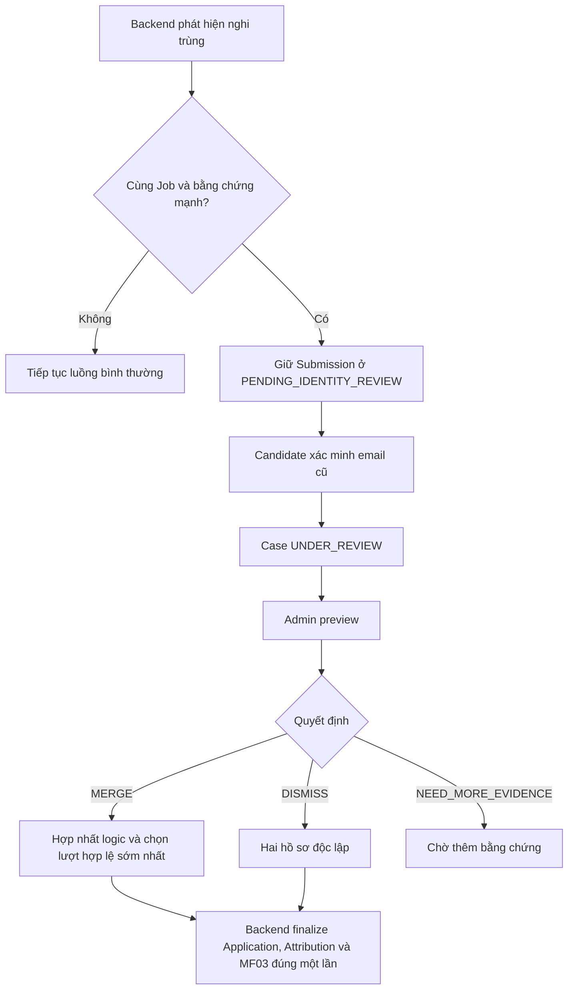

# Hồ sơ Candidate nghi trùng và khiếu nại quyền giới thiệu

## Mục tiêu

Luồng này xử lý trường hợp một người có nhiều hồ sơ do dùng email, số điện thoại hoặc Affiliate khác nhau. Backend không tự gộp chỉ từ tên hoặc nội dung CV. Candidate chứng minh quyền sở hữu, Admin xem tác động rồi mới hợp nhất hoặc xác nhận không trùng.

Không thu thập CCCD. FE không hiển thị Affiliate đối thủ, contact đầy đủ, raw CV, hash/fingerprint hoặc ghi chú nội bộ cho Candidate/Affiliate.

## Quyền

| Actor | Permission |
|---|---|
| Candidate | `candidate.identity.manage_own` |
| Admin xem case | `candidate_duplicate.view` |
| Admin preview/resolve | `candidate_duplicate.resolve` |
| Affiliate tạo/xem khiếu nại | `dispute.create`, `dispute.view_own` |
| Admin xem/xử lý khiếu nại | `dispute.view`, `dispute.resolve` |

## Luồng tổng quát



## Candidate xem case của mình

Route FE đề xuất: `/candidate/settings/duplicate-cases` và `/candidate/settings/duplicate-cases/:caseId`.

### Danh sách

`GET /api/v1/candidates/me/duplicate-cases?status=&page=1&pageSize=20`

Response chỉ có dữ liệu an toàn:

- `duplicateCaseId`, `status`, `riskLevel`;
- `title`, `guidance`, `actionRequired` đã được backend viết cho người dùng;
- Job/doanh nghiệp nếu case gắn với một Job;
- `evidenceTypes`: `VERIFIED_EMAIL`, `MATCHING_CV_AND_NAME`, `OTHER_REVIEW_SIGNAL`;
- thời gian tạo/cập nhật.

### Chi tiết

`GET /api/v1/candidates/me/duplicate-cases/{caseId}`

Nếu case không thuộc tài khoản, backend trả `404` để không lộ sự tồn tại. FE không dựng thêm tên/contact của hồ sơ còn lại.

### Status Candidate

| Status | UI |
|---|---|
| `AWAITING_CANDIDATE` | Cảnh báo cần xác minh; dẫn đến trang Email & hồ sơ liên kết |
| `UNDER_REVIEW` | Đã nhận bằng chứng, đang chờ Admin |
| `BLOCKED_FINANCE` | Đang xử lý quyền lợi liên quan; không hứa thời gian hoàn tất |
| `MERGED` | Thành công; reload profile, CV, applications và auth/me |
| `DISMISSED` | Kết thúc, hai hồ sơ độc lập |
| `OPEN` | Đang chờ đối chiếu |

Khi verify OTP trả `PENDING_ADMIN_REVIEW`, response có thể kèm `duplicateCaseId`. Nếu có, FE mở đúng detail. Nếu không có, giữ màn trạng thái claim cũ.

## Admin xử lý case

Route FE đề xuất: `/admin/candidate-duplicate-cases` và `/admin/candidate-duplicate-cases/:caseId`.

| API | Chức năng |
|---|---|
| `GET /api/v1/admin/candidate-duplicate-cases` | Hàng đợi, filter status/risk/job/company/date/search, pagination |
| `GET /api/v1/admin/candidate-duplicate-cases/{caseId}` | Hai hồ sơ đã mask, signals, submissions, consent, application, attribution, commission |
| `POST /api/v1/admin/candidate-duplicate-cases/{caseId}/preview-merge` | Xem canonical đề xuất, collision theo Job và blocker tài chính |
| `POST /api/v1/admin/candidate-duplicate-cases/{caseId}/resolve` | MERGE, DISMISS hoặc NEED_MORE_EVIDENCE |

Request resolve:

```json
{
  "decision": "MERGE",
  "reason": "Đã đối chiếu email được xác minh và lịch sử hồ sơ.",
  "concurrencyToken": "00000000-0000-0000-0000-000000000000",
  "idempotencyKey": "uuid-tao-mot-lan-cho-lan-bam-nay"
}
```

- Luôn gọi preview trước `MERGE`.
- Dùng token mới nhất từ detail; `409` thì reload.
- Mỗi lần người dùng bấm xử lý tạo một `idempotencyKey`, giữ nguyên key khi retry do timeout/mất mạng.
- `finalizationResults` cho biết lượt nào đã tạo Application/Attribution hoặc vì sao bị bỏ qua.
- `BLOCKED_FINANCE`/paid payout: khóa MERGE và hướng Admin xử lý tài chính trước.

## Khiếu nại Affiliate

### Tạo và xem của tôi

- `POST /api/v1/disputes`
- `GET /api/v1/disputes/mine?status=`

`evidenceNote` nhận ghi chú thường hoặc URL **HTTPS** hợp lệ. Không gửi URL `http://`, token truy cập, cookie hay dữ liệu bí mật. Khi Submission thuộc case đang hoạt động, Backend tự liên kết `candidateDuplicateCaseId`; FE không tự đoán ID.

### Admin xem và resolve

- `GET /api/v1/admin/disputes`
- `GET /api/v1/admin/disputes/{disputeId}`
- `POST /api/v1/admin/disputes/{disputeId}/resolve`

Request resolve:

```json
{
  "decision": "UPHELD",
  "resolution": "Bằng chứng xác nhận Affiliate này có quyền giới thiệu hợp lệ.",
  "concurrencyToken": "token-tu-api-detail",
  "idempotencyKey": "uuid-tao-mot-lan-cho-lan-bam-nay"
}
```

`UPHELD` chỉ thành công khi có attribution đang hoạt động, Affiliate khiếu nại còn hợp lệ và hoa hồng chưa `PAID`. Không hiển thị thành công nếu nhận một trong các lỗi:

| Error code | UI |
|---|---|
| `STALE_DISPUTE_RESOLUTION` | Reload detail, yêu cầu Admin kiểm tra lại |
| `DISPUTE_NOT_OPEN` | Đã được người khác xử lý; reload |
| `DISPUTE_ATTRIBUTION_MISSING` | Không có attribution để chuyển; giữ trạng thái hiện tại |
| `DISPUTE_AFFILIATE_MISSING` | Affiliate không còn hợp lệ |
| `DISPUTE_TRANSFER_NOT_REQUIRED` | Quyền hiện đã thuộc người khiếu nại |
| `DISPUTE_COMMISSION_ALREADY_PAID` | Khóa xử lý và chuyển quy trình điều chỉnh tài chính |

## Invalidate cache

- Candidate case thay đổi: duplicate cases, auth/me, profile, CV, applications.
- Admin resolve case: admin case list/detail/preview, submissions, applications, attribution, commission.
- Resolve dispute: dispute list/detail, attribution, commission/payout và notification.

## Checklist FE

- [ ] Candidate không thấy thông tin hồ sơ khác ngoài nội dung backend cho phép.
- [ ] Không hiển thị hash, raw evidence JSON hoặc Affiliate đối thủ ở Candidate/Affiliate UI.
- [ ] Preview trước MERGE và hiển thị đầy đủ finance blockers.
- [ ] Mỗi mutation dùng concurrency token mới nhất và idempotency key ổn định khi retry.
- [ ] Khóa nút trong lúc request chạy; không tự retry mutation bằng key mới.
- [ ] Status/error dùng lời tiếng Việt dễ hiểu, không đưa enum kỹ thuật làm tiêu đề chính.
- [ ] Sau MERGE/DISMISS/UPHELD/REJECTED reload toàn bộ dữ liệu liên quan.

## Ghi chú deploy

Backend phải chạy migration `HardenDisputeResolution` trước khi FE gửi `idempotencyKey`. Không phát hành màn resolve mới nếu backend Swagger chưa có `concurrencyToken` và `idempotencyKey`.
