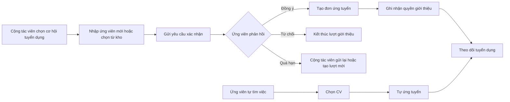

# Hướng dẫn sử dụng luồng MF02 trên Frontend

> **Phạm vi:** Candidate/CV Submission, xác nhận của ứng viên, kho CV, kho ứng viên, quyền ghi nhận và đối chiếu danh tính.  
> **Đối tượng:** Cộng tác viên tuyển dụng, Ứng viên và Quản trị viên.  
> **Phiên bản tài liệu:** 1.1 — cập nhật theo giao diện FE hiện tại ngày 31/10/2026.

## 1. Mục đích tài liệu

Tài liệu này hướng dẫn người dùng thao tác trên giao diện HR Connect, không mô tả cách gọi API hay cấu trúc code. Sau khi đọc, người dùng có thể:

- Ứng viên tự ứng tuyển, quản lý CV, theo dõi đơn và phản hồi yêu cầu giới thiệu.
- Cộng tác viên tìm việc làm, giới thiệu ứng viên, theo dõi tiến trình và quản lý quyền ghi nhận.
- Quản trị viên đối chiếu yêu cầu liên kết danh tính và tra cứu nhật ký hệ thống.

Các thao tác được mô tả theo đúng màn hình đang có trên FE. Tên trạng thái kỹ thuật chỉ xuất hiện trong bảng đối chiếu ở cuối tài liệu để hỗ trợ kiểm thử.

### 1.1. MF02 làm gì trong hệ thống?

**MF02 — Tiếp nhận và giới thiệu hồ sơ ứng viên** là luồng kết nối Ứng viên, Cộng tác viên tuyển dụng và nhu cầu tuyển dụng đã được doanh nghiệp mở trên HR Connect. Mục đích chính của MF02 là đưa một hồ sơ ứng viên vào đúng công việc theo cách **có sự đồng ý của ứng viên, chống nộp trùng và xác định rõ quyền giới thiệu của Cộng tác viên** trước khi hồ sơ chuyển sang bước sàng lọc.

MF02 giải quyết bốn vấn đề nghiệp vụ chính:

1. **Tiếp nhận hồ sơ từ hai nguồn:** Ứng viên có thể tự ứng tuyển; Cộng tác viên có thể giới thiệu ứng viên mới hoặc chọn ứng viên đã được phép lưu trong kho.
2. **Bảo vệ quyền quyết định của Ứng viên:** Hồ sơ do Cộng tác viên gửi chỉ trở thành đơn ứng tuyển sau khi Ứng viên xem thông tin công việc, CV được sử dụng và chủ động đồng ý.
3. **Kiểm soát trùng và danh tính:** Hệ thống đối chiếu email, số điện thoại và các hồ sơ liên quan để hạn chế một người bị tạo thành nhiều Candidate hoặc bị nộp nhiều lần vào cùng một công việc.
4. **Ghi nhận nguồn giới thiệu minh bạch:** Khi yêu cầu hợp lệ được Ứng viên xác nhận, hệ thống ghi nhận Cộng tác viên gắn với lượt giới thiệu để làm căn cứ theo dõi tiến trình, xử lý khiếu nại và tính quyền lợi ở MF05.

| Thành phần | Nội dung trong MF02 |
|---|---|
| Đầu vào | Tin tuyển dụng đang nhận hồ sơ, thông tin Ứng viên, CV và sự đồng ý của Ứng viên |
| Xử lý chính | Tự ứng tuyển hoặc giới thiệu, gửi yêu cầu xác nhận, đối chiếu trùng, phản hồi đồng ý/từ chối và ghi nhận nguồn giới thiệu |
| Đầu ra thành công | Một đơn ứng tuyển hợp lệ gắn đúng Candidate, đúng công việc, đúng CV và đúng nguồn giới thiệu |
| Đầu ra không thành công | Yêu cầu bị từ chối, hết hạn, trùng hoặc không đủ điều kiện; không tạo đơn ứng tuyển sai |
| Luồng tiếp theo | Hồ sơ hợp lệ được chuyển sang MF03 để sàng lọc/chấm điểm và tiếp tục quy trình tuyển dụng |

> **Cách trình bày ngắn trước hội đồng:** MF02 bảo đảm hồ sơ được đưa vào quy trình tuyển dụng từ đúng nguồn, có sự đồng ý của ứng viên, hạn chế trùng lặp và ghi nhận minh bạch quyền giới thiệu của Cộng tác viên trước khi chuyển sang sàng lọc.

## 2. Tổng quan luồng sử dụng

### Nguyên tắc quan trọng

1. Ứng viên **tự ứng tuyển** thì không cần bước xác nhận của cộng tác viên.
2. Cộng tác viên gửi hồ sơ thì hệ thống chỉ tạo **lượt giới thiệu chờ xác nhận**.
3. Chỉ khi ứng viên đồng ý, hệ thống mới tạo đơn ứng tuyển và quyền ghi nhận cho cộng tác viên.
4. FE không tự tạo đơn ứng tuyển, quyền ghi nhận hoặc yêu cầu chấm điểm AI; backend xử lý các bước này sau khi ứng viên xác nhận.
5. Ứng viên luôn có quyền xem CV, công việc và doanh nghiệp trước khi đồng ý hoặc từ chối.

## 3. Bản đồ màn hình

### 3.1. Khu vực Ứng viên

| Màn hình | Đường dẫn | Mục đích |
|---|---|---|
| Việc làm phù hợp | `/candidate/jobs` | Xem việc làm được gợi ý theo hồ sơ |
| Tất cả việc làm | `/candidate/jobs?tab=all` | Tìm kiếm, lọc và xem chi tiết việc làm |
| Đơn ứng tuyển | `/candidate/applications` | Theo dõi đơn đã nộp và yêu cầu cần xác nhận |
| Chi tiết đơn | `/candidate/applications/{applicationId}` | Xem tiến trình, phỏng vấn và thư mời nhận việc |
| Xác nhận giới thiệu | `/candidate/submission-consents/{submissionId}` | Đồng ý hoặc từ chối hồ sơ do cộng tác viên gửi |
| Kho CV | `/candidate/cvs` | Tải lên, xem, sửa và chọn CV chính |
| Tạo CV | `/candidate/cv-builder` | Tạo CV trực tiếp trên hệ thống |
| CV do cộng tác viên tải | `/candidate/affiliate-cvs` | Xem, nhận về kho cá nhân hoặc giới hạn tái sử dụng CV |
| Email liên kết | `/candidate/settings/email-identities` | Xác minh email khác để nhận lại hồ sơ cũ |
| Hồ sơ cá nhân | `/candidate/profile` | Cập nhật thông tin nghề nghiệp phục vụ ứng tuyển và gợi ý việc làm |

### 3.2. Khu vực Cộng tác viên

| Menu | Đường dẫn | Mục đích |
|---|---|---|
| Tổng quan | `/affiliate/dashboard` | Xem các việc cần xử lý và số liệu chính |
| Tìm cơ hội tuyển dụng | `/affiliate/jobs` | Tìm công việc cho ứng viên |
| Giới thiệu ứng viên | `/affiliate/submit-candidate` | Gửi hồ sơ mới hoặc hồ sơ từ kho |
| Lượt giới thiệu | `/affiliate/submissions` | Theo dõi yêu cầu xác nhận và tiến trình ứng viên |
| Kho ứng viên | `/affiliate/candidates` | Quản lý ứng viên đã được phép lưu và tái sử dụng |
| Quyền ghi nhận | `/affiliate/attributions` | Xem quyền giới thiệu đã được hệ thống ghi nhận |
| Kết quả giới thiệu | `/affiliate/performance` | Theo dõi hiệu quả giới thiệu |
| Khiếu nại | `/affiliate/disputes` | Gửi và theo dõi khiếu nại thuộc quyền của mình |
| Hoa hồng & chi trả | `/affiliate/commissions` | Theo dõi quyền lợi tài chính thuộc MF05 |
| Hồ sơ & cài đặt | `/affiliate/profile` | Quản lý hồ sơ cộng tác viên |

### 3.3. Khu vực Quản trị viên liên quan MF02

| Màn hình | Đường dẫn | Mục đích |
|---|---|---|
| Danh tính Candidate | `/admin/candidate-identity-claims` | Duyệt yêu cầu liên kết hai hồ sơ ứng viên |
| Chi tiết yêu cầu | `/admin/candidate-identity-claims/{claimId}` | So sánh bằng chứng và phê duyệt hoặc từ chối |
| Nhật ký hệ thống | `/admin/audit-trail` | Tra cứu lịch sử thay đổi và người thực hiện |

> Trang tranh chấp phía Admin hiện chưa phải luồng hoàn chỉnh trên FE, vì vậy không đưa vào các bước hướng dẫn vận hành chính của tài liệu này.

## 4. Hướng dẫn cho Ứng viên

### 4.1. Tự ứng tuyển một việc làm

1. Đăng nhập bằng tài khoản Ứng viên.
2. Chọn **Việc làm** hoặc **Phù hợp với bạn** trên thanh điều hướng.
3. Tìm việc theo từ khóa, địa điểm và các bộ lọc đang hiển thị.
4. Chọn một thẻ việc làm để mở trang chi tiết.
5. Đọc kỹ mô tả công việc, yêu cầu, quyền lợi và thông tin doanh nghiệp.
6. Chọn **Ứng tuyển**.
7. Chọn một CV trong kho hoặc tải lên CV PDF mới.
8. Kiểm tra lại CV và xác nhận nộp hồ sơ.
9. Vào **Đơn ứng tuyển** để theo dõi kết quả.

**Kết quả mong đợi:** đơn xuất hiện trong danh sách của Ứng viên. Luồng này không yêu cầu xác nhận qua email vì chính Ứng viên thực hiện thao tác.

### 4.2. Xác nhận hồ sơ do Cộng tác viên giới thiệu

Ứng viên có thể mở yêu cầu từ thông báo trong hệ thống, tab yêu cầu xác nhận ở **Đơn ứng tuyển**, hoặc liên kết trong email.

1. Mở yêu cầu xác nhận.
2. Kiểm tra các thông tin:
   - Tên công việc và doanh nghiệp.
   - CV được gửi kèm.
   - Thời hạn phản hồi.
3. Chọn **Xem CV** nếu cần kiểm tra nội dung.
4. Chọn một trong hai quyết định:
   - **Đồng ý nộp hồ sơ:** cho phép dùng CV cho đúng công việc đang hiển thị.
   - **Từ chối:** không cho phép tiếp tục lượt giới thiệu này.
5. Xác nhận lại quyết định trong hộp thoại nếu giao diện yêu cầu.

**Sau khi đồng ý:** hệ thống tạo đơn ứng tuyển, ghi nhận quyền giới thiệu cho Cộng tác viên và tiếp tục quy trình tuyển dụng.

**Sau khi từ chối:** lượt giới thiệu kết thúc; không tạo đơn ứng tuyển cho công việc đó.

#### Trường hợp Ứng viên chưa có tài khoản

1. Mở liên kết trong email.
2. Xem nội dung yêu cầu và CV ngay trên trang xác nhận công khai.
3. Chọn **Đồng ý nộp hồ sơ** hoặc **Từ chối**.
4. Không cần tạo tài khoản để phản hồi yêu cầu này.

Không chia sẻ liên kết xác nhận cho người khác vì liên kết là bằng chứng truy cập email của Ứng viên.

### 4.3. Theo dõi đơn ứng tuyển

1. Mở **Đơn ứng tuyển**.
2. Dùng tab hoặc bộ lọc để xem:
   - Đơn ứng tuyển đã tạo.
   - Yêu cầu giới thiệu đang chờ phản hồi.
3. Chọn **Xem chi tiết** tại đơn cần kiểm tra.
4. Theo dõi thanh tiến trình, lịch phỏng vấn, thư mời nhận việc và dòng thời gian tuyển dụng.
5. Khi có lịch phỏng vấn hoặc thư mời, thực hiện phản hồi trực tiếp tại màn hình chi tiết tương ứng.

FE luôn hiển thị trạng thái công khai bằng tiếng Việt. Người dùng không cần hiểu các mã workflow nội bộ.

### 4.4. Quản lý kho CV

1. Mở **Kho CV** tại `/candidate/cvs`.
2. Chọn một thao tác:
   - **Tạo CV mới:** mở CV Builder.
   - **Tải CV PDF:** thêm CV có sẵn.
   - **Xem:** kiểm tra nội dung CV.
   - **Sửa:** chỉnh tên hoặc nội dung được hỗ trợ.
   - **Đặt làm CV chính:** ưu tiên CV khi ứng tuyển.
   - **Xóa:** chỉ thực hiện khi CV không bị ràng buộc bởi dữ liệu đang sử dụng.
3. Kiểm tra nhãn số đơn ứng tuyển đang sử dụng CV trước khi xóa.

### 4.5. Quản lý CV do Cộng tác viên tải lên

1. Mở `/candidate/affiliate-cvs`.
2. Chọn một CV để xem chi tiết và các lần CV được sử dụng.
3. Tùy tình trạng CV, Ứng viên có thể:
   - Nhận CV về kho cá nhân.
   - Cho phép hoặc thu hồi quyền tái sử dụng trong tương lai.
   - Xem công việc và trạng thái đơn liên quan.

Việc thu hồi tái sử dụng không tự động xóa các đơn đã được Ứng viên xác nhận trước đó.

### 4.6. Liên kết email để nhận lại hồ sơ cũ

Sử dụng khi Cộng tác viên từng gửi hồ sơ bằng một email khác với email đăng nhập hiện tại.

1. Mở **Email liên kết** tại `/candidate/settings/email-identities`.
2. Nhập email cần liên kết.
3. Chọn **Gửi mã xác minh**.
4. Mở email, lấy mã OTP và nhập vào màn hình xác minh.
5. Gửi xác minh.
6. Theo dõi kết quả:
   - Liên kết ngay nếu hồ sơ an toàn để hợp nhất.
   - Chuyển Admin đối chiếu nếu hai hồ sơ đều có dữ liệu nghiệp vụ cần bảo toàn.

Không dùng email của người khác. Admin có thể từ chối nếu bằng chứng không đủ hoặc thông tin không khớp.

## 5. Hướng dẫn cho Cộng tác viên

### 5.1. Tìm cơ hội tuyển dụng

1. Đăng nhập bằng tài khoản Cộng tác viên.
2. Chọn **Tìm cơ hội tuyển dụng**.
3. Tìm kiếm và lọc công việc phù hợp với ứng viên.
4. Mở chi tiết để kiểm tra yêu cầu, địa điểm, hình thức làm việc và thông tin doanh nghiệp.
5. Chọn **Giới thiệu ứng viên** nếu công việc đang nhận hồ sơ từ Cộng tác viên.

Nếu công việc chỉ nhận Ứng viên tự ứng tuyển, màn hình gửi hồ sơ sẽ yêu cầu chọn cơ hội khác.

### 5.2. Giới thiệu một Ứng viên mới

1. Mở **Giới thiệu ứng viên**.
2. Tại bước **Chọn cơ hội tuyển dụng**:
   - Tìm theo tên vị trí, kỹ năng hoặc doanh nghiệp.
   - Chọn đúng một công việc.
3. Tại bước **Thông tin ứng viên**, chọn **Ứng viên mới**.
4. Nhập họ tên, email và số điện thoại của Ứng viên.
5. Tải lên CV định dạng PDF.
6. Nhập ghi chú ngắn về điểm mạnh của Ứng viên nếu cần.
7. Kiểm tra lại khối **Giới thiệu vào** ở bên phải.
8. Chọn **Gửi yêu cầu xác nhận**.

**Kết quả mong đợi:** giao diện báo đã gửi yêu cầu xác nhận. Đây chưa phải là “ứng tuyển thành công”; Cộng tác viên cần chờ Ứng viên đồng ý.

Nếu email gửi thất bại, không nộp lại hồ sơ. Mở **Lượt giới thiệu** và dùng chức năng gửi lại yêu cầu.

### 5.3. Giới thiệu từ Kho ứng viên

Chỉ dùng cho ứng viên và CV còn hoạt động, đã được phép tái sử dụng.

1. Mở **Giới thiệu ứng viên**.
2. Chọn công việc.
3. Tại **Thông tin ứng viên**, chọn **Chọn từ kho**.
4. Tìm theo tên, email hoặc số điện thoại.
5. Chọn Ứng viên.
6. Chọn một CV đang hoạt động.
7. Thêm ghi chú nếu cần và gửi yêu cầu xác nhận.

Ứng viên vẫn phải đồng ý cho từng lượt giới thiệu vào công việc mới.

### 5.4. Theo dõi Lượt giới thiệu

1. Mở **Lượt giới thiệu**.
2. Lọc theo trạng thái, công việc hoặc khoảng ngày gửi.
3. Kiểm tra cột **Trạng thái** và tiến trình tuyển dụng.
4. Chọn **Xem chi tiết** để xem:
   - Thông tin Ứng viên và CV.
   - Thời gian gửi, hạn xác nhận và thời gian phản hồi.
   - Đơn ứng tuyển đã được tạo hay chưa.
   - Quyền giới thiệu đã được ghi nhận hay chưa.
5. Nếu đang **Chờ Ứng viên xác nhận**, chọn **Gửi lại yêu cầu xác nhận** khi nút khả dụng.

Mỗi lần gửi lại tạo liên kết mới và làm liên kết cũ mất hiệu lực. Hệ thống có thời gian chờ giữa hai lần gửi và giới hạn số lần gửi.

### 5.5. Quản lý Kho ứng viên

1. Mở **Kho ứng viên**.
2. Tìm theo tên, email hoặc số điện thoại.
3. Mở hồ sơ để xem thông tin và danh sách CV.
4. Chọn CV còn hoạt động để giới thiệu vào công việc khác.
5. Nếu CV bị thu hồi quyền tái sử dụng hoặc không còn hoạt động, yêu cầu Ứng viên cung cấp/cho phép CV khác.

### 5.6. Kiểm tra Quyền ghi nhận

1. Mở **Quyền ghi nhận**.
2. Tìm theo Ứng viên hoặc công việc.
3. Kiểm tra thời điểm bắt đầu, thời hạn và trạng thái quyền ghi nhận.
4. Chỉ xem quyền ghi nhận là hợp lệ khi Ứng viên đã đồng ý và hệ thống hiển thị quyền đã được tạo.
5. Nếu dữ liệu không khớp, thu thập bằng chứng rồi mở **Khiếu nại**.

## 6. Hướng dẫn cho Quản trị viên

### 6.1. Đối chiếu yêu cầu liên kết danh tính

1. Mở **Danh tính Candidate**.
2. Lọc hoặc sắp xếp danh sách yêu cầu cần xử lý.
3. Chọn một yêu cầu để mở chi tiết.
4. So sánh **Hồ sơ Candidate hiện tại** và **Hồ sơ Candidate cũ theo email**:
   - Thông tin nhận diện.
   - Số CV.
   - Lượt giới thiệu.
   - Đơn ứng tuyển.
   - Dữ liệu điểm AI liên quan.
5. Chọn:
   - **Phê duyệt** khi có đủ bằng chứng hai hồ sơ thuộc cùng một người.
   - **Từ chối** khi thông tin không khớp hoặc bằng chứng không đủ.
6. Nhập lý do rõ ràng và xác nhận quyết định.

### 6.2. Tra cứu Nhật ký hệ thống

1. Mở **Nhật ký hệ thống**.
2. Lọc theo hành động, người thực hiện, đối tượng hoặc khoảng thời gian.
3. Mở bản ghi cần kiểm tra để đối chiếu lịch sử.
4. Dùng nhật ký làm bằng chứng khi xử lý sai lệch danh tính hoặc quyền ghi nhận.

## 7. Bảng trạng thái dễ hiểu

### 7.1. Lượt giới thiệu của Cộng tác viên

| Trạng thái hiển thị | Ý nghĩa | Người dùng nên làm gì |
|---|---|---|
| Đã tiếp nhận | Hệ thống đang kiểm tra dữ liệu | Chờ cập nhật |
| Chờ Ứng viên xác nhận | Email đã được gửi, chưa có quyết định | Nhắc Ứng viên kiểm tra email; gửi lại khi được phép |
| Đang xác minh Ứng viên | Cần xác minh/liên kết hồ sơ | Chờ Ứng viên hoặc Admin xử lý |
| Đã cho phép giới thiệu | Ứng viên đã đồng ý | Theo dõi tiến trình tuyển dụng |
| Ứng viên từ chối | Ứng viên đã từ chối | Kết thúc lượt này; không gửi lại khi chưa có sự đồng ý mới |
| Hết hạn xác nhận | Không phản hồi trong thời hạn | Liên hệ Ứng viên và tạo lượt mới nếu còn nhu cầu |
| Bị chặn do trùng | Phát hiện hồ sơ trùng trong cùng công việc | Kiểm tra lịch sử; khiếu nại nếu có bằng chứng |
| Doanh nghiệp đã có hồ sơ | Ứng viên thuộc luồng ưu tiên của doanh nghiệp | Không tiếp tục lượt giới thiệu này |
| Tin không còn nhận hồ sơ | Công việc đã đóng hoặc ngừng nhận | Chọn công việc khác |
| Đã hủy | Lượt giới thiệu không còn hoạt động | Chỉ xem lịch sử |

### 7.2. Đơn ứng tuyển của Ứng viên

| Nhóm hiển thị | Ý nghĩa |
|---|---|
| Đã nộp | Hồ sơ đã vào hệ thống |
| Đang được xem | Doanh nghiệp đang xem xét hồ sơ |
| Được chọn | Hồ sơ đã qua bước chọn lọc |
| Phỏng vấn | Đang trong quy trình phỏng vấn |
| Chờ offer | Doanh nghiệp đang chuẩn bị thư mời |
| Đã nhận offer | Thư mời đã được gửi cho Ứng viên |
| Đi làm | Ứng viên đã được ghi nhận nhận việc |
| Chưa phù hợp | Quy trình tuyển dụng đã kết thúc mà không được chọn |
| Đã rút | Ứng viên chủ động rút đơn |

## 8. Tình huống thường gặp

| Tình huống | Cách xử lý trên FE |
|---|---|
| Ứng viên không thấy email | Kiểm tra spam; Cộng tác viên mở chi tiết lượt giới thiệu và gửi lại khi nút khả dụng |
| Liên kết xác nhận hết hạn | Cộng tác viên liên hệ Ứng viên rồi tạo yêu cầu mới theo hướng dẫn trên màn hình |
| Liên kết cũ không mở được sau khi gửi lại | Dùng email mới nhất; liên kết cũ đã bị vô hiệu hóa |
| CV PDF không tải lên được | Kiểm tra đúng PDF và dung lượng không vượt giới hạn hiển thị |
| Không chọn được CV trong kho | CV đã bị thu hồi, lưu trữ hoặc không còn hoạt động; chọn CV khác |
| Không chọn được công việc | Công việc có thể đã đóng hoặc không nhận hồ sơ từ Cộng tác viên |
| Hệ thống báo trùng hồ sơ | Mở lịch sử lượt giới thiệu; không nộp lặp; khiếu nại nếu có bằng chứng |
| Đăng nhập nhưng không xem được yêu cầu xác nhận | Tài khoản đang dùng không liên kết với đúng Ứng viên; đổi tài khoản hoặc xác minh email |
| Hai hồ sơ thuộc cùng một người | Ứng viên xác minh email liên kết; Admin đối chiếu nếu hệ thống yêu cầu |

## 9. Kịch bản demo cho Review

### Kịch bản A — Cộng tác viên giới thiệu thành công

1. Cộng tác viên mở **Tìm cơ hội tuyển dụng** và chọn một công việc.
2. Chọn **Giới thiệu ứng viên**, nhập thông tin và tải CV PDF.
3. Gửi yêu cầu; màn hình hiển thị **Chờ Ứng viên xác nhận**.
4. Ứng viên mở email hoặc tab yêu cầu xác nhận, xem CV và chọn **Đồng ý nộp hồ sơ**.
5. Cộng tác viên tải lại chi tiết lượt giới thiệu.
6. Kiểm tra đơn ứng tuyển và quyền ghi nhận đã được tạo.
7. Ứng viên mở **Đơn ứng tuyển** và thấy công việc vừa xác nhận.

### Kịch bản B — Ứng viên từ chối

1. Cộng tác viên gửi một yêu cầu giới thiệu khác.
2. Ứng viên mở yêu cầu và chọn **Từ chối**.
3. Cộng tác viên thấy trạng thái **Ứng viên không đồng ý**.
4. Kiểm tra không có đơn ứng tuyển và quyền ghi nhận mới.

### Kịch bản C — Liên kết hồ sơ cũ

1. Ứng viên mở **Email liên kết** và nhập email từng dùng trong hồ sơ do Cộng tác viên gửi.
2. Nhập OTP xác minh.
3. Nếu yêu cầu cần đối chiếu, Admin mở **Danh tính Candidate**.
4. Admin xem hai hồ sơ, nhập lý do và phê duyệt hoặc từ chối.
5. Kiểm tra kết quả và nhật ký hệ thống.

## 10. Danh sách ảnh nên chụp cho tài liệu bàn giao

1. Màn hình Cộng tác viên chọn cơ hội tuyển dụng.
2. Form giới thiệu ứng viên ở chế độ **Ứng viên mới**.
3. Form giới thiệu ở chế độ **Chọn từ kho**.
4. Kết quả gửi yêu cầu xác nhận thành công.
5. Danh sách **Lượt giới thiệu** có nhiều trạng thái.
6. Chi tiết lượt giới thiệu và nút gửi lại email.
7. Màn hình Ứng viên xem yêu cầu xác nhận.
8. Màn hình kết quả sau khi đồng ý và sau khi từ chối.
9. Danh sách và chi tiết **Đơn ứng tuyển**.
10. Kho CV cá nhân và CV do Cộng tác viên tải.
11. Màn hình Email liên kết/nhập OTP.
12. Admin đối chiếu hai hồ sơ Candidate.
13. Nhật ký hệ thống sau khi Admin xử lý.

Khi chụp ảnh, dùng dữ liệu demo, che email/số điện thoại thật và không để lộ token xác nhận trên thanh địa chỉ.

## 11. Checklist xác nhận luồng FE

### Ứng viên

- [ ] Tự ứng tuyển và thấy đơn mới trong danh sách.
- [ ] Xem được CV trước khi phản hồi yêu cầu giới thiệu.
- [ ] Đồng ý và từ chối yêu cầu đều có màn hình kết quả rõ ràng.
- [ ] Trạng thái danh sách và chi tiết đơn thống nhất.
- [ ] Quản lý được CV cá nhân và CV do Cộng tác viên tải.
- [ ] Gửi và xác minh được email liên kết.

### Cộng tác viên

- [ ] Chỉ thấy các công việc nhận hồ sơ từ Cộng tác viên.
- [ ] Gửi được Ứng viên mới và Ứng viên từ kho.
- [ ] Không hiển thị “ứng tuyển thành công” trước khi Ứng viên đồng ý.
- [ ] Lọc và xem được lịch sử lượt giới thiệu.
- [ ] Gửi lại email đúng điều kiện.
- [ ] Theo dõi được quyền ghi nhận và tiến trình tuyển dụng.

### Admin

- [ ] Lọc và mở được yêu cầu liên kết danh tính.
- [ ] So sánh được dữ liệu hai hồ sơ trước khi quyết định.
- [ ] Phê duyệt/từ chối có lý do và hộp thoại xác nhận.
- [ ] Tra cứu được hành động trong Nhật ký hệ thống.

## 12. Phạm vi không thuộc hướng dẫn này

- Thao tác nội bộ của Client/Internal HR sau khi nhận hồ sơ.
- Cách cấu hình API, biến môi trường, database hoặc storage.
- Thuật toán chấm điểm AI của MF03.
- Luồng tính hoa hồng và chi trả chi tiết của MF05.

Các nội dung tích hợp kỹ thuật vẫn được mô tả trong các tài liệu `00` đến `13` của cùng thư mục.
