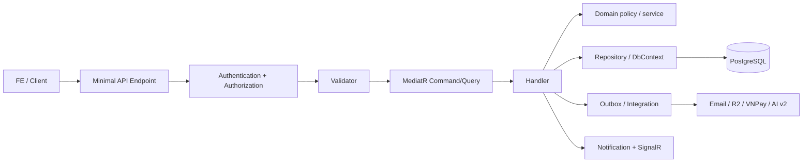
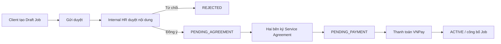
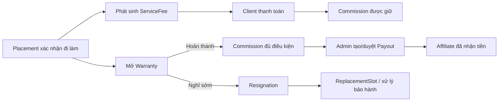

# Cẩm nang luồng nghiệp vụ, API và đường đi code Backend HR Connect

> Tài liệu nhập môn dành cho Backend Developer, Frontend Developer, QA và AI coding agent.  
> Mục tiêu: đọc tài liệu này trước để hiểu **hệ thống làm gì**, **API nào chịu trách nhiệm**, **dữ liệu đi qua đâu** và **nên mở file nào khi cần sửa**.

## 0. Phạm vi và nguồn sự thật

Tài liệu này là **bản đồ tổng** của Backend, không thay thế OpenAPI/Swagger hoặc các tài liệu chi tiết của từng Main Flow.

- Source of truth cho route: [`HRConnect.Presentation/Endpoints`](../HRConnect.Presentation/Endpoints/).
- Source of truth cho nghiệp vụ: [`HRConnect.Application/Features`](../HRConnect.Application/Features/).
- Source of truth cho entity và quy tắc miền: [`HRConnect.Domain`](../HRConnect.Domain/).
- Source of truth cho database và dịch vụ ngoài: [`HRConnect.Infrastructure`](../HRConnect.Infrastructure/).
- Điểm khởi động ứng dụng: [`HRConnect.Presentation/Program.cs`](../HRConnect.Presentation/Program.cs).
- Luồng MF02 ở mức từng class: [`MF02/CODE-EXECUTION-FLOW.md`](MF02/CODE-EXECUTION-FLOW.md).

Khi tài liệu và code khác nhau, **code của nhánh đang chạy là nguồn quyết định cuối cùng**. Sau khi đổi endpoint hoặc trạng thái nghiệp vụ, phải cập nhật lại tài liệu này trong cùng pull request.

---

## 1. Bức tranh tổng thể

HR Connect kết nối sáu nhóm người dùng:

| Actor | Trách nhiệm chính |
|---|---|
| Guest | Xem việc, xem doanh nghiệp, đăng ký và xác minh email. |
| Candidate | Quản lý hồ sơ/CV, tự ứng tuyển, xác nhận lượt giới thiệu, tham gia phỏng vấn và phản hồi offer. |
| Affiliate | Giới thiệu Candidate, theo dõi lượt giới thiệu, attribution, tranh chấp, hoa hồng và payout. |
| Client/Company User | Tạo job, ký thỏa thuận, thanh toán, xem CV, phỏng vấn, gửi offer và xác nhận nhận việc. |
| Internal HR | Duyệt job, sàng lọc Candidate, điều phối tuyển dụng, đối soát nhận việc và bảo hành. |
| Platform Admin | Quản trị tài khoản, RBAC, cấu hình, xử lý trùng, tranh chấp, phí, hoa hồng, payout và báo cáo. |

Chuỗi dữ liệu cốt lõi:

```text
Company -> Job -> Submission -> Application -> Interview -> Offer -> Placement
                    |               |                          |
                    |               +-> AI result              +-> Warranty
                    +-> Consent                                 +-> ServiceFee
                    +-> Attribution                             +-> Commission -> Payout
                    +-> Dispute                                 +-> ReplacementSlot
```

Phân biệt ba khái niệm dễ nhầm:

| Khái niệm | Ý nghĩa |
|---|---|
| `Submission` | Mọi lượt nộp/giới thiệu vào Job, kể cả lượt đang chờ consent hoặc bị chặn vì trùng. |
| `Application` | Hồ sơ ứng tuyển chính thức sau khi lượt nộp hợp lệ. Pipeline tuyển dụng chạy trên bản ghi này. |
| `Attribution` | Ghi nhận Affiliate nào sở hữu quyền giới thiệu hợp lệ để giải quyết tranh chấp và tính hoa hồng. |

---

## 2. Kiến trúc và đường đi chung của một request

Backend dùng Clean Architecture kết hợp Minimal API, MediatR và EF Core.



### 2.1 Các lớp và trách nhiệm

| Layer | Có gì trong đó | Không nên đặt ở đây |
|---|---|---|
| Presentation | Route, binding request, auth policy, HTTP status, response mapping. | Quy tắc nghiệp vụ dài, truy vấn EF trực tiếp. |
| Application | Command/Query, validator, handler, DTO, orchestration nghiệp vụ. | Chi tiết HTTP, secret, SDK hạ tầng cụ thể. |
| Domain | Entity, enum/status, policy và invariant cốt lõi. | Gọi database hoặc API ngoài. |
| Infrastructure | EF Core, PostgreSQL, R2, email, AI client, VNPay, background worker. | Quyết định nghiệp vụ thuộc use case. |

### 2.2 Pipeline trong `Program.cs`

Ứng dụng khởi động theo thứ tự chính:

1. Đọc `.env`, environment variables và `appsettings`.
2. Kiểm tra cấu hình Production bằng fail-fast validator.
3. Đăng ký Application/Infrastructure services.
4. Cấu hình Problem Details, health check, JWT, CORS, rate limiting và SignalR.
5. Áp middleware: forwarded headers, request logging, exception handling, HTTPS, CORS, authentication, rate limit, authorization.
6. Map endpoint modules.
7. Production chỉ migrate khi chạy tiến trình một lần với `--migrate`; không migrate âm thầm trong mỗi lần start API.

Health endpoints:

| Method | Route | Ý nghĩa |
|---|---|---|
| GET | `/health/live` | Process API còn sống. Không phụ thuộc database. |
| GET | `/health/ready` | API sẵn sàng nhận traffic, bao gồm kiểm tra PostgreSQL. |

---

## 3. Xác thực, phiên đăng nhập và RBAC

### 3.1 Luồng

1. Người dùng đăng ký đúng loại tài khoản.
2. Hệ thống gửi OTP email.
3. Xác minh OTP để kích hoạt tài khoản.
4. Đăng nhập trả access token; refresh token được quản lý bằng cookie HttpOnly.
5. Endpoint kiểm tra role/permission trước khi gửi command/query.
6. Admin có thể gán role và quyền truy cập động cho từng người dùng.

### 3.2 API chính

| Method | Route | Mục đích |
|---|---|---|
| POST | `/api/v1/auth/register/candidate` | Đăng ký Candidate. |
| POST | `/api/v1/auth/register/affiliate` | Đăng ký Affiliate. |
| POST | `/api/v1/auth/register/client` | Đăng ký Client/Company User. |
| POST | `/api/v1/auth/verify-email-otp` | Xác minh email. |
| POST | `/api/v1/auth/verify-email-otp/resend` | Gửi lại OTP. |
| POST | `/api/v1/auth/login` | Đăng nhập. |
| POST | `/api/v1/auth/refresh-token` | Cấp access token mới từ refresh cookie. |
| POST | `/api/v1/auth/logout` | Thu hồi phiên hiện tại. |
| POST | `/api/v1/auth/logout-all` | Thu hồi mọi phiên của user. |
| POST | `/api/v1/auth/forgot-password` | Bắt đầu quên mật khẩu. |
| POST | `/api/v1/auth/reset-password` | Đặt lại mật khẩu. |
| PUT | `/api/v1/auth/change-password` | Đổi mật khẩu khi đã đăng nhập. |
| GET | `/api/v1/auth/me` | Lấy user, role và quyền hiện tại. |

Admin RBAC nằm dưới `/api/v1/admin/authorization`:

- Quản lý danh mục permission.
- CRUD role và cấu hình permission của role.
- Xem quyền hiệu lực của một user.
- Gán/gỡ role cho user.
- Gán quyền ngoại lệ và đưa user về quyền mặc định theo role.

**Điểm vào code:** [`AuthEndpoints.cs`](../HRConnect.Presentation/Endpoints/V1/Auth/AuthEndpoints.cs), [`AdminAuthorizationEndpoints.cs`](../HRConnect.Presentation/Endpoints/V1/Admin/AdminAuthorizationEndpoints.cs).

---

## 4. MF01 — Tạo Job, duyệt thương mại, ký thỏa thuận và kích hoạt

### 4.1 Mục đích

Biến nhu cầu tuyển dụng của doanh nghiệp thành một Job hợp lệ, đã được HR Connect kiểm tra, có điều khoản dịch vụ rõ ràng và hoàn thành nghĩa vụ thanh toán trước khi công bố.

### 4.2 Luồng chính



### 4.3 Quy tắc quan trọng

- Client chỉ quản lý Job thuộc Company của mình.
- Job phải gắn `ServiceType`; các điều khoản thương mại thay đổi theo loại dịch vụ.
- Phiên bản thỏa thuận không bị ghi đè; lịch sử phải còn để audit.
- Không tin nút “đã chuyển khoản” từ FE. VNPay IPN/return phải được Backend kiểm tra chữ ký, số tiền và mã giao dịch.
- Job chỉ mở tuyển khi đã qua các gate bắt buộc của service type.

### 4.4 API chính

| Nhóm | API tiêu biểu | Mục đích |
|---|---|---|
| Client Job | `POST /api/v1/jobs` | Tạo Job nháp. |
| Client Job | `PUT /api/v1/jobs/{jobId}` | Sửa Job. |
| Client Job | `POST /api/v1/jobs/{jobId}/submit` | Gửi duyệt. |
| Client Job | `POST /api/v1/jobs/{jobId}/pause` | Tạm dừng nhận hồ sơ. |
| Client Job | `POST /api/v1/jobs/{jobId}/resume` | Mở lại Job. |
| Client Job | `POST /api/v1/jobs/{jobId}/close` | Đóng Job. |
| Query | `GET /api/v1/jobs/mine` | Job của doanh nghiệp hiện tại. Mỗi job có `submittedAt` (lần gửi duyệt gần nhất), `statusChangedAt` và `statusReasonCode` (lần đổi trạng thái gần nhất), `depositSubmittedAt` (doanh nghiệp báo đã nộp cọc; `hasSubmittedDeposit` đọc từ cột này), và với CV_SOURCING: `depositAmount`, `paymentDueAt` lấy từ phiếu DEPOSIT thật (null khi chưa có phiếu; `paymentDueAt` null khi phiếu đã trả). |
| Query | `GET /api/v1/jobs/{jobId}` | Chi tiết Job theo quyền truy cập. |
| Public | `GET /api/v1/public/jobs` | Danh sách Job công khai. |
| Internal HR | `GET /api/v1/internal/jobs/review` | Hàng đợi duyệt Job. |
| Internal HR | `POST /api/v1/internal/jobs/{jobId}/approve` | Duyệt Job. |
| Internal HR | `POST /api/v1/internal/jobs/{jobId}/reject` | Từ chối Job. |
| Agreement | `GET /api/v1/jobs/{jobId}/service-agreement` | Thỏa thuận hiện hành. |
| Agreement | `GET /api/v1/jobs/{jobId}/service-agreements` | Lịch sử phiên bản. |
| Agreement | `POST /api/v1/internal/jobs/{jobId}/service-agreements` | Tạo đề xuất thỏa thuận. |
| Agreement | `POST /api/v1/client/jobs/{jobId}/service-agreements/{agreementId}/response` | Client đồng ý/yêu cầu chỉnh sửa. |
| Agreement | `POST /api/v1/client/jobs/{jobId}/service-agreements/{agreementId}/signature-challenges` | Tạo thử thách ký. |
| Agreement | `POST /api/v1/client/jobs/{jobId}/service-agreements/{agreementId}/sign` | Ký điện tử. |
| Payment | `POST /api/v1/jobs/{jobId}/posting-fee/pay` | Khởi tạo thanh toán phí đăng. |
| VNPay | `POST /api/v1/payments/vnpay` | Tạo giao dịch VNPay. |
| VNPay | `GET /api/v1/payments/vnpay/ipn` | Callback server-to-server, nguồn xác nhận chính. |
| VNPay | `GET /api/v1/payments/vnpay/return` | Điều hướng người dùng sau thanh toán. |
| Template | `/api/v1/job-templates` | Client dùng mẫu tuyển dụng. |
| Template Admin | `/api/v1/internal/job-templates` | Internal HR quản lý mẫu. |

**Điểm vào code:** [`JobEndpoints.cs`](../HRConnect.Presentation/Endpoints/V1/Jobs/JobEndpoints.cs), [`ServiceAgreementEndpoints.cs`](../HRConnect.Presentation/Endpoints/V1/Jobs/ServiceAgreementEndpoints.cs), [`VnPayPaymentEndpoints.cs`](../HRConnect.Presentation/Endpoints/V1/Finance/VnPayPaymentEndpoints.cs).

---

## 5. MF02 — Candidate, CV, lượt nộp, consent, chống trùng và attribution

### 5.1 Mục đích

Đảm bảo một con người có hồ sơ nhất quán, mỗi lượt giới thiệu có bằng chứng đồng ý, một Job không có nhiều Application hợp lệ cho cùng Candidate, và quyền ghi nhận Affiliate có thể giải thích/audit.

### 5.2 Hai đường vào Job

#### Candidate tự ứng tuyển

```text
Candidate chọn Job + CV
-> POST /api/v1/jobs/{jobId}/apply
-> kiểm tra Job/Candidate/CV/trùng
-> tạo Submission hợp lệ
-> tạo Application SUBMITTED
-> gửi yêu cầu AI
```

Không tạo Affiliate attribution vì Candidate tự nộp.

#### Affiliate giới thiệu Candidate

```text
Affiliate nhập Candidate + CV
-> tạo Submission PENDING_CONSENT
-> tạo SubmissionConsent PENDING
-> gửi email cho Candidate
-> Candidate đồng ý
-> kiểm tra identity/trùng/quyền ưu tiên
-> tạo Application SUBMITTED
-> tạo Attribution ACTIVE
-> gửi yêu cầu AI
```

Nếu có dấu hiệu cùng người nhưng khác email/điện thoại, hệ thống chuyển sang `PENDING_IDENTITY_REVIEW` thay vì tự hợp nhất nguy hiểm.

### 5.3 Quy tắc chống trùng và hợp nhất

- Email/số điện thoại phải chuẩn hóa trước khi so sánh.
- Email đã xác minh là bằng chứng chính; tên, phone, ngày sinh và CV là tín hiệu hỗ trợ.
- Cùng người, cùng Job: chỉ một lượt hợp lệ/được xác nhận sớm nhất giữ quyền ưu tiên theo policy.
- Hai hồ sơ đều có dữ liệu nghiệp vụ thì không được xóa/ghi đè mù quáng.
- Admin phải xem preview xung đột trước khi resolve/merge.
- Lịch sử, dispute, application và dữ liệu tài chính phải còn truy vết sau hợp nhất.

### 5.4 API chính

| Actor | Method + Route | Mục đích |
|---|---|---|
| Candidate | `POST /api/v1/jobs/{jobId}/apply` | Tự ứng tuyển. |
| Affiliate | `POST /api/v1/jobs/{jobId}/candidate-submissions` | Giới thiệu Candidate. |
| Candidate public | `POST /api/v1/submission-consents/review` | Xem yêu cầu bằng token. |
| Candidate public | `POST /api/v1/submission-consents/respond` | Đồng ý/từ chối bằng token. |
| Candidate login | `GET /api/v1/candidates/me/submission-consents` | Danh sách yêu cầu đang chờ. |
| Candidate login | `POST /api/v1/candidates/me/submission-consents/{id}/respond` | Phản hồi khi đã đăng nhập. |
| Affiliate | `GET /api/v1/affiliates/submissions` | Theo dõi lượt đã gửi. |
| Affiliate | `GET /api/v1/affiliates/submissions/{id}` | Chi tiết lượt giới thiệu. |
| Affiliate | `POST /api/v1/affiliates/submissions/{id}/consent/resend` | Gửi lại email consent có giới hạn. |
| Affiliate | `GET /api/v1/affiliates/attributions` | Xem quyền ghi nhận. |
| Affiliate | `GET /api/v1/affiliates/candidates` | Kho Candidate của Affiliate. |
| Dispute | `POST /api/v1/disputes` | Mở khiếu nại trùng/attribution. |
| Dispute | `GET /api/v1/disputes/mine` | Người gửi theo dõi khiếu nại. |
| Admin | `GET /api/v1/admin/candidate-duplicate-cases` | Danh sách hồ sơ nghi trùng. |
| Admin | `GET /api/v1/admin/candidate-duplicate-cases/{id}` | Bằng chứng và xung đột. |
| Admin | `POST /api/v1/admin/candidate-duplicate-cases/{id}/preview-merge` | Mô phỏng kết quả trước khi hợp nhất. |
| Admin | `POST /api/v1/admin/candidate-duplicate-cases/{id}/resolve` | Xử lý/hợp nhất có audit. |
| Admin | `GET /api/v1/admin/disputes` | Hàng đợi tranh chấp. |
| Admin | `POST /api/v1/admin/disputes/{id}/resolve` | Giải quyết tranh chấp. |

Candidate profile/CV còn có các route family:

- `/api/v1/candidates/profile/me`: hồ sơ cá nhân và nghề nghiệp.
- `/api/v1/candidates/cv`: upload, xem, chọn CV chính và xóa CV.
- `/api/v1/candidates/profile/me/skills`: kỹ năng.
- `/api/v1/candidates/cv/structured`: CV Builder dạng dữ liệu có cấu trúc.
- `/api/v1/cv-templates`: mẫu CV.
- `/api/v1/candidates/me/job-matches`: việc làm được gợi ý.
- Candidate saved jobs: lưu/bỏ lưu Job.

**Điểm vào code:** [`CandidateEndpoints.cs`](../HRConnect.Presentation/Endpoints/V1/Candidates/CandidateEndpoints.cs), [`AffiliateEndpoints.cs`](../HRConnect.Presentation/Endpoints/V1/Affiliates/AffiliateEndpoints.cs), [`SubmissionConsentEndpoints.cs`](../HRConnect.Presentation/Endpoints/V1/SubmissionConsents/SubmissionConsentEndpoints.cs), [`AdminCandidateDuplicateEndpoints.cs`](../HRConnect.Presentation/Endpoints/V1/Admin/AdminCandidateDuplicateEndpoints.cs), [`DisputeEndpoints.cs`](../HRConnect.Presentation/Endpoints/V1/Disputes/DisputeEndpoints.cs).

Chi tiết từng class: [`MF02/CODE-EXECUTION-FLOW.md`](MF02/CODE-EXECUTION-FLOW.md).

---

## 6. MF03 — AI Matching v2

### 6.1 Mục đích

Chấm mức phù hợp giữa CV và Job để hỗ trợ sàng lọc. AI chỉ đưa ra **tín hiệu hỗ trợ**, không thay HR đưa ra quyết định tuyển dụng.

### 6.2 Luồng

```text
Application hợp lệ
-> Backend ghi AI dispatch job bền vững
-> worker gửi jobId/applicationId sang ai-service-v2
-> AI lấy JD/CV qua internal API có service token
-> AI phân tích và callback kết quả
-> Backend xác minh request, lưu AiMatchResult
-> cập nhật notification/tín hiệu cho HR
```

### 6.3 Quy tắc

- Dùng `ai-service-v2`; không nối trực tiếp FE với AI service.
- Dữ liệu private chỉ đi qua internal endpoint có service token.
- Dispatch phải retry an toàn; callback phải idempotent.
- Không tự động reject Candidate chỉ dựa trên điểm AI.
- Lưu score, tier, trạng thái và dữ liệu giải thích cần thiết để audit.

### 6.4 API liên quan

| Route family | Mục đích |
|---|---|
| `GET /api/v1/internal/jobs/{jobId}/jd` | AI lấy dữ liệu JD đã kiểm soát. |
| `GET /api/v1/internal/ai-results/{applicationId}` | Kiểm tra kết quả hiện tại/idempotency. |
| `POST /api/v1/internal/ai-results` | AI callback kết quả chấm. |
| `POST /api/v1/internal/applications/{applicationId}/ai-scoring/retry` | Internal HR yêu cầu chấm lại khi job lỗi hợp lệ. |

**Điểm vào code:** [`AiIntegrationEndpoints.cs`](../HRConnect.Presentation/Endpoints/Internal/AiIntegrationEndpoints.cs), [`InternalHrEndpoints.cs`](../HRConnect.Presentation/Endpoints/V1/InternalHr/InternalHrEndpoints.cs).  
Tài liệu chuyên sâu: [`MF03/`](MF03/).

---

## 7. MF04 — Screening, Interview, Offer và Placement

### 7.1 Mục đích

Điều phối Application từ lúc được tiếp nhận đến khi Candidate nhận việc, đồng thời giữ lịch sử trạng thái và bằng chứng phản hồi của các bên.

### 7.2 Pipeline chuẩn

```text
SUBMITTED
-> SCREENING
-> SHORTLISTED
-> INTERVIEW
-> OFFER_PENDING
-> OFFER_ACCEPTED
-> PLACED
```

Các nhánh kết thúc có thể gồm `REJECTED`, `INTERVIEW_FAILED`, `OFFER_DECLINED`, rút hồ sơ hoặc không đi làm. Không được “nhảy lùi” trạng thái chỉ vì một màn hình đọc nhầm field.

### 7.3 Thành phần

| Thành phần | Ý nghĩa |
|---|---|
| ApplicationStatusHistory | Ai đổi trạng thái, từ gì sang gì, lúc nào và vì sao. |
| SourcingDelivery | CV nào đã được giao cho Client trong dịch vụ Sourcing. |
| Interview | Lịch, hình thức, phản hồi Candidate và kết quả từng vòng. |
| Offer | Điều kiện đề nghị, trạng thái gửi/đồng ý/từ chối/rút. |
| Placement | Sự kiện Candidate thực sự bắt đầu làm; là cầu nối sang tài chính/bảo hành. |
| PlacementReconciliation | Internal HR đối soát việc Candidate có thật sự đi làm hay không. |

### 7.4 API chính

| Nhóm | API tiêu biểu |
|---|---|
| Pipeline | `PATCH /api/v1/jobs/{jobId}/applications/{applicationId}/status` |
| Pipeline | `POST /api/v1/jobs/{jobId}/applications/{applicationId}/start-screening` |
| Application | `GET /api/v1/recruitment/applications` |
| Application | `GET /api/v1/recruitment/applications/{id}` |
| Application | CV masked/download, timeline, withdraw, backup decision dưới cùng route family. |
| Interview | `POST /api/v1/recruitment/applications/{applicationId}/interviews` |
| Interview | `/api/v1/interviews`: list/detail/update/reschedule/cancel/no-show/result/history. List nhận `fromDate`, `toDate` (ISO, quy về UTC), `sortDirection` (`ASC`/`DESC`, theo `scheduledAt`). |
| Candidate | `POST /api/v1/interviews/{id}/candidate-confirm` |
| Offer | `/api/v1/offers`: list/detail/update/send/response/withdraw. |
| Placement | `/api/v1/placements`: list/detail và sửa ngày bắt đầu. |
| Reconciliation | `/api/v1/internal-hr/placement-reconciliations` |
| Reconciliation | `/api/v1/admin/placement-reconciliations` |

**Điểm vào code:** [`RecruitmentEndpoints.cs`](../HRConnect.Presentation/Endpoints/V1/Recruitment/RecruitmentEndpoints.cs), [`InterviewEndpoints.cs`](../HRConnect.Presentation/Endpoints/V1/Recruitment/InterviewEndpoints.cs), [`OfferEndpoints.cs`](../HRConnect.Presentation/Endpoints/V1/Recruitment/OfferEndpoints.cs), [`PlacementEndpoints.cs`](../HRConnect.Presentation/Endpoints/V1/Recruitment/PlacementEndpoints.cs), [`PlacementReconciliationEndpoints.cs`](../HRConnect.Presentation/Endpoints/V1/Recruitment/PlacementReconciliationEndpoints.cs), [`SourcingDeliveryEndpoints.cs`](../HRConnect.Presentation/Endpoints/V1/Recruitment/SourcingDeliveryEndpoints.cs).

---

## 8. MF05 — Phí dịch vụ, bảo hành, thay thế, hoa hồng và payout

### 8.1 Mục đích

Tách dòng tiền khỏi pipeline tuyển dụng nhưng vẫn truy ngược được về Job, Application, Placement và Attribution.

### 8.2 Luồng Headhunt điển hình



### 8.3 Nguyên tắc

- `ServiceFee` là khoản Client phải trả cho Platform.
- `Commission` là khoản Platform dự kiến trả Affiliate, dựa trên `Attribution` và `CommissionRule`.
- `Payout` là lần chuyển tiền thực tế; một Commission có thể có nhiều lần payout.
- Không đánh dấu đã thanh toán chỉ từ thao tác FE; phải dựa trên giao dịch được xác minh hoặc thao tác Admin có audit theo policy.
- Candidate không phải bên nhận/chia commission trong luồng mặc định.
- Warranty và replacement phải gắn Placement gốc để không mất lịch sử.

### 8.4 API chính

Các route dưới `/api/v1`:

| Method + Route | Mục đích |
|---|---|
| `POST /placements/{placementId}/resignation` | Báo Candidate nghỉ việc. |
| `POST /placements/{placementId}/resignation/resolve` | Internal HR/Admin xác minh và xử lý. |
| `GET /placements/{placementId}` | Chi tiết nhận việc, kèm khối `financial`: Client chỉ thấy phí dịch vụ (`serviceFeeAmount`, `serviceFeeStatus`), hoa hồng Affiliate chỉ trả cho Internal HR/Admin, Candidate không nhận khối này; `null` khi chưa có phí lẫn hoa hồng. |
| `GET /replacement-slots` | Danh sách lượt thay thế có phân trang (`jobId`, `status`, `page`, `pageSize` ≤ 100), mỗi lượt có `jobTitle` và `companyName`. Client (thành viên ACTIVE) chỉ thấy lượt của doanh nghiệp mình; Internal HR/Admin thấy tất cả. |
| `GET /jobs/{jobId}/replacement-slots` | Các lượt thay thế của Job. |
| `POST /internal/replacement-slots/{id}/cancel` | Hủy lượt thay thế hợp lệ. |
| `GET /placements/{placementId}` | Chi tiết nhận việc, kèm khối `financial`: Client chỉ thấy phí dịch vụ (`serviceFeeAmount`, `serviceFeeStatus`), hoa hồng Affiliate chỉ trả cho Internal HR/Admin, Candidate không nhận khối này; `null` khi chưa có phí lẫn hoa hồng. |
| `GET /replacement-slots` | Danh sách lượt thay thế có phân trang (`jobId`, `status`, `page`, `pageSize` ≤ 100), mỗi lượt có `jobTitle` và `companyName`. Client (thành viên ACTIVE) chỉ thấy lượt của doanh nghiệp mình; Internal HR/Admin thấy tất cả. |
| `GET /client/dashboard/summary` | Client (placement.confirm, thành viên ACTIVE), chỉ doanh nghiệp mình: tổng phí chưa trả (PLACEMENT, DEPOSIT, SETTLEMENT) và phần quá hạn, hạn phí gần nhất, khoản hoàn/credit đang nợ doanh nghiệp, số CV Sourcing chờ phản hồi và hạn gần nhất, số bảo hành ACTIVE kết thúc trong `warrantyWithinDays` ngày (mặc định 7, tối đa 90), số suất thay thế OPEN/WAITING_PAYMENT. |
| `GET /warranties` | Theo dõi bảo hành. |
| `GET /service-fees` | Theo dõi công nợ/phí. |
| `POST /jobs/{jobId}/sourcing-settlement` | Chốt phí dịch vụ Sourcing. |
| `POST /admin/service-fees/{id}/record-payment` | Ghi nhận thanh toán theo quyền Admin. |
| `GET /commissions` | Danh sách hoa hồng theo actor/quyền. |
| `POST /admin/commissions/{id}/approve` | Duyệt commission đủ điều kiện. |
| `POST /admin/commissions/{id}/cancel` | Hủy commission có lý do và audit. |
| `POST /admin/commissions/{id}/adjust` | Điều chỉnh commission theo quyền Admin. |
| `POST /admin/commissions/{id}/payouts` | Tạo lần chi trả thực tế cho Affiliate. |
| `GET /payouts` | Danh sách payout. |

Các cấu hình liên quan:

- `/api/v1/admin/commission-rules`: quy tắc tính hoa hồng.
- `/api/v1/admin/commission-milestones`: mốc đủ điều kiện chi.
- `/api/v1/admin/settings`: cấu hình nghiệp vụ dùng chung.
- `/api/v1/admin/posting-packages`: gói đăng tin.

**Điểm vào code:** [`FinanceEndpoints.cs`](../HRConnect.Presentation/Endpoints/V1/Finance/FinanceEndpoints.cs), [`CommissionRuleEndpoints.cs`](../HRConnect.Presentation/Endpoints/V1/CommissionRules/CommissionRuleEndpoints.cs), [`CommissionMilestoneEndpoints.cs`](../HRConnect.Presentation/Endpoints/V1/CommissionMilestones/CommissionMilestoneEndpoints.cs), [`PostingPackageAdminEndpoints.cs`](../HRConnect.Presentation/Endpoints/V1/Finance/PostingPackageAdminEndpoints.cs).  
Tài liệu chi tiết: [`MF05/`](MF05/), [`QUY-TAC-PHI-VA-HOA-HONG-3-DICH-VU.md`](QUY-TAC-PHI-VA-HOA-HONG-3-DICH-VU.md).

---

## 9. Các module dùng chung

### 9.1 Company và directory

| Route family | Chức năng |
|---|---|
| `/api/v1/companies/profile/me` | Xem/cập nhật hồ sơ Company hiện tại. |
| `POST/DELETE /api/v1/companies/profile/me/logo` | Upload/xóa logo riêng của Company. Không dùng avatar Client làm logo. |
| `/api/v1/public/companies` | Directory doanh nghiệp, featured và detail. |
| `/api/v1/industries` | Danh mục lĩnh vực/ngành. |
| `/api/v1/company-sizes` | Danh mục quy mô. |

Code: [`CompanyEndpoints.cs`](../HRConnect.Presentation/Endpoints/V1/Companies/CompanyEndpoints.cs), [`CompanyDirectoryEndpoints.cs`](../HRConnect.Presentation/Endpoints/V1/Companies/CompanyDirectoryEndpoints.cs).

### 9.2 Avatar và lưu trữ file

- Avatar user: `/api/v1/users/me/avatar`.
- Logo Company: endpoint riêng của Company.
- CV và file ký được lưu qua storage abstraction; database chỉ lưu metadata/object key, không nhét file nhị phân lớn vào bảng nghiệp vụ.
- Download private file phải dùng URL ký có thời hạn và kiểm tra quyền trước khi phát hành.

Code: [`UserEndpoints.cs`](../HRConnect.Presentation/Endpoints/V1/Users/UserEndpoints.cs), Candidate/Company endpoints và Infrastructure storage services.

### 9.3 Notification và realtime

| API | Chức năng |
|---|---|
| `GET /api/v1/notifications` | Danh sách thông báo. |
| `GET /api/v1/notifications/unread-count` | Số chưa đọc. |
| Mark one/all as read | Cập nhật trạng thái đọc. |

SignalR đẩy sự kiện nhanh đến FE; database vẫn là nguồn sự thật. Mất kết nối realtime không được làm mất thông báo nghiệp vụ.

Code: [`NotificationEndpoints.cs`](../HRConnect.Presentation/Endpoints/V1/Notifications/NotificationEndpoints.cs).

### 9.4 Báo cáo và audit

- `/api/v1/reports/overview`
- `/api/v1/reports/revenue`
- `/api/v1/reports/top-affiliates`
- `/api/v1/reports/top-companies`
- Admin audit logs và affiliate performance.

Audit phải trả lời được: **ai**, **làm gì**, **đối tượng nào**, **lúc nào**, **trước/sau** và **correlation ID**.

Code: [`ReportEndpoints.cs`](../HRConnect.Presentation/Endpoints/V1/Reports/ReportEndpoints.cs), [`AdminAuditLogEndpoints.cs`](../HRConnect.Presentation/Endpoints/V1/Admin/AdminAuditLogEndpoints.cs), [`AdminAffiliatePerformanceEndpoints.cs`](../HRConnect.Presentation/Endpoints/V1/Reports/AdminAffiliatePerformanceEndpoints.cs).

### 9.5 Contact và cấu hình danh mục

- `POST /api/v1/public/contact-requests`: khách gửi yêu cầu tư vấn.
- Admin contact requests: xem và cập nhật trạng thái xử lý.
- `/api/v1/service-types`: loại dịch vụ và role được phép dùng.
- Admin approval/profile/users/settings: vận hành hệ thống.

---

## 10. Background jobs và tích hợp ngoài

| Thành phần | Vai trò | Yêu cầu an toàn |
|---|---|---|
| Email outbox/dispatcher | Gửi OTP, consent, thông báo nghiệp vụ. | Retry, không gửi trùng vô hạn, lưu lỗi. |
| AI dispatch worker | Gửi Application sang AI v2. | Persistent queue, backoff, idempotency. |
| Consent expiry | Hết hạn yêu cầu xác nhận. | Không chấp nhận token hết hạn. |
| Notification dispatcher | Lưu và đẩy notification. | DB là nguồn sự thật, realtime là kênh bổ sung. |
| R2/object storage | CV, avatar, logo, tài liệu. | Kiểm tra loại/kích thước file, signed URL ngắn hạn. |
| VNPay | Thu phí/deposit. | Verify chữ ký, amount, order, trạng thái; IPN idempotent. |

Khi thêm worker mới, cần có:

1. Bản ghi bền vững hoặc outbox; không chỉ giữ job trong RAM.
2. Trạng thái retry và giới hạn số lần.
3. Idempotency key hoặc điều kiện chống xử lý hai lần.
4. Log có correlation/business ID.
5. Cơ chế quan sát và thao tác retry hợp lệ.

---

## 11. Quy ước lỗi, đồng thời và bảo mật

### 11.1 HTTP và Problem Details

| Status | Khi dùng |
|---|---|
| 400 | Request sai định dạng hoặc vi phạm validation. |
| 401 | Chưa đăng nhập/token không hợp lệ. |
| 403 | Đã đăng nhập nhưng thiếu role/permission hoặc không sở hữu resource. |
| 404 | Resource không tồn tại hoặc không được lộ cho actor. |
| 409 | Xung đột trạng thái, trùng dữ liệu hoặc request đã được actor khác xử lý. |
| 422 | Dữ liệu đúng cú pháp nhưng không thể xử lý theo nghiệp vụ. |
| 429 | Vượt rate limit. |
| 500 | Lỗi không dự kiến; không trả stack trace/secret cho client. |
| 503 | Dependency chưa sẵn sàng, ví dụ readiness database thất bại. |

### 11.2 Các nguyên tắc bắt buộc

- Không tin `userId`, `companyId`, role hoặc amount do FE tự khai nếu có thể lấy từ token/database.
- Mọi thay đổi trạng thái phải kiểm tra trạng thái hiện tại và transition hợp lệ.
- Callback/payment/worker phải idempotent.
- Dùng transaction cho cụm cập nhật bắt buộc cùng thành công.
- Trả `409 Conflict` khi hai Admin cùng xử lý một yêu cầu; FE phải tải dữ liệu mới.
- Không log access token, refresh token, OTP, service token, API key hoặc connection string.
- Endpoint internal phải có service authentication riêng, không chỉ dựa vào URL khó đoán.
- Upload phải giới hạn kích thước ở Caddy và Backend, kiểm tra nội dung thực tế thay vì chỉ tin extension.

---

## 12. Cách tìm code khi nhận task

### 12.1 Checklist 8 bước cho Developer/AI agent

1. Xác định actor và Main Flow (MF01–MF05).
2. Tìm route trong [`Endpoints`](../HRConnect.Presentation/Endpoints/).
3. Từ endpoint đi tới Command/Query tương ứng.
4. Đọc validator và handler; không chỉ đọc DTO.
5. Kiểm tra domain status/policy và transition liên quan.
6. Kiểm tra DbContext/configuration, unique index và migration.
7. Kiểm tra integration/background worker/notification phát sinh.
8. Viết test cho happy path, permission, validation, conflict và idempotency.

### 12.2 Mẫu truy vết một API

```text
Route
-> request DTO/binding
-> authorization policy
-> Command/Query
-> Validator
-> Handler
-> Domain policy/entity
-> Repository/DbContext
-> transaction/save
-> outbox/integration/notification
-> response + HTTP status
```

### 12.3 Khi thêm API mới

- Dùng `/api/v1` và đặt route cạnh module nghiệp vụ hiện có.
- Đặt tên theo tài nguyên/nghiệp vụ, không theo tên màn hình FE.
- Khai báo authorization rõ ràng.
- Có validator và response contract ổn định.
- Không để handler “khổng lồ”; tách policy/service dùng lại khi cần.
- Thêm audit cho thao tác nhạy cảm.
- Thêm unit/integration test và cập nhật tài liệu.
- Nếu đổi schema, tạo migration riêng; production chạy migration one-shot trước switch traffic.

---

## 13. Mục lục API theo file nguồn

Đây là danh mục để tìm **toàn bộ endpoint chính xác** khi route chi tiết thay đổi:

| Phạm vi | File endpoint |
|---|---|
| Auth/session | [`AuthEndpoints.cs`](../HRConnect.Presentation/Endpoints/V1/Auth/AuthEndpoints.cs) |
| Candidate/CV/profile | [`CandidateEndpoints.cs`](../HRConnect.Presentation/Endpoints/V1/Candidates/CandidateEndpoints.cs) |
| CV Builder | [`CvBuilderEndpoints.cs`](../HRConnect.Presentation/Endpoints/V1/Candidates/CvBuilderEndpoints.cs) |
| Candidate skills | [`CandidateSkillEndpoints.cs`](../HRConnect.Presentation/Endpoints/V1/Candidates/CandidateSkillEndpoints.cs) |
| Job match | [`JobMatchEndpoints.cs`](../HRConnect.Presentation/Endpoints/V1/Candidates/JobMatchEndpoints.cs) |
| Affiliate | [`AffiliateEndpoints.cs`](../HRConnect.Presentation/Endpoints/V1/Affiliates/AffiliateEndpoints.cs) |
| Consent | [`SubmissionConsentEndpoints.cs`](../HRConnect.Presentation/Endpoints/V1/SubmissionConsents/SubmissionConsentEndpoints.cs) |
| Job | [`JobEndpoints.cs`](../HRConnect.Presentation/Endpoints/V1/Jobs/JobEndpoints.cs) |
| Job template | [`JobTemplateEndpoints.cs`](../HRConnect.Presentation/Endpoints/V1/Jobs/JobTemplateEndpoints.cs) |
| Agreement | [`ServiceAgreementEndpoints.cs`](../HRConnect.Presentation/Endpoints/V1/Jobs/ServiceAgreementEndpoints.cs) |
| Company | [`CompanyEndpoints.cs`](../HRConnect.Presentation/Endpoints/V1/Companies/CompanyEndpoints.cs) |
| Company directory | [`CompanyDirectoryEndpoints.cs`](../HRConnect.Presentation/Endpoints/V1/Companies/CompanyDirectoryEndpoints.cs) |
| Recruitment/Application | [`RecruitmentEndpoints.cs`](../HRConnect.Presentation/Endpoints/V1/Recruitment/RecruitmentEndpoints.cs) |
| Interview | [`InterviewEndpoints.cs`](../HRConnect.Presentation/Endpoints/V1/Recruitment/InterviewEndpoints.cs) |
| Offer | [`OfferEndpoints.cs`](../HRConnect.Presentation/Endpoints/V1/Recruitment/OfferEndpoints.cs) |
| Placement | [`PlacementEndpoints.cs`](../HRConnect.Presentation/Endpoints/V1/Recruitment/PlacementEndpoints.cs) |
| Placement reconciliation | [`PlacementReconciliationEndpoints.cs`](../HRConnect.Presentation/Endpoints/V1/Recruitment/PlacementReconciliationEndpoints.cs) |
| Sourcing delivery | [`SourcingDeliveryEndpoints.cs`](../HRConnect.Presentation/Endpoints/V1/Recruitment/SourcingDeliveryEndpoints.cs) |
| Finance/MF05 | [`FinanceEndpoints.cs`](../HRConnect.Presentation/Endpoints/V1/Finance/FinanceEndpoints.cs) |
| VNPay | [`VnPayPaymentEndpoints.cs`](../HRConnect.Presentation/Endpoints/V1/Finance/VnPayPaymentEndpoints.cs) |
| Commission rules | [`CommissionRuleEndpoints.cs`](../HRConnect.Presentation/Endpoints/V1/CommissionRules/CommissionRuleEndpoints.cs) |
| Commission milestones | [`CommissionMilestoneEndpoints.cs`](../HRConnect.Presentation/Endpoints/V1/CommissionMilestones/CommissionMilestoneEndpoints.cs) |
| Dispute | [`DisputeEndpoints.cs`](../HRConnect.Presentation/Endpoints/V1/Disputes/DisputeEndpoints.cs) |
| Admin users | [`AdminUserEndpoints.cs`](../HRConnect.Presentation/Endpoints/V1/Admin/AdminUserEndpoints.cs) |
| Admin RBAC | [`AdminAuthorizationEndpoints.cs`](../HRConnect.Presentation/Endpoints/V1/Admin/AdminAuthorizationEndpoints.cs) |
| Admin duplicate | [`AdminCandidateDuplicateEndpoints.cs`](../HRConnect.Presentation/Endpoints/V1/Admin/AdminCandidateDuplicateEndpoints.cs) |
| Notifications | [`NotificationEndpoints.cs`](../HRConnect.Presentation/Endpoints/V1/Notifications/NotificationEndpoints.cs) |
| Reports | [`ReportEndpoints.cs`](../HRConnect.Presentation/Endpoints/V1/Reports/ReportEndpoints.cs) |
| Internal AI | [`AiIntegrationEndpoints.cs`](../HRConnect.Presentation/Endpoints/Internal/AiIntegrationEndpoints.cs) |

---

## 14. Đọc tiếp theo nhu cầu

- Tổng quan luồng: [`main-flows.md`](main-flows.md).
- Actor và trách nhiệm: [`3. ACTOR — CÁC TÁC NHÂN CỦA HỆ THỐNG.md`](3.%20ACTOR%20%E2%80%94%20C%C3%81C%20T%C3%81C%20NH%C3%82N%20C%E1%BB%A6A%20H%E1%BB%86%20TH%E1%BB%90NG.md).
- MF01: [`MF01/`](MF01/).
- MF02: [`MF02/`](MF02/), đặc biệt [`MF02/CODE-EXECUTION-FLOW.md`](MF02/CODE-EXECUTION-FLOW.md).
- MF03: [`MF03/`](MF03/).
- MF04: [`MF04/`](MF04/).
- MF05: [`MF05/`](MF05/).
- Audit logging: [`shared-audit-logging.md`](shared-audit-logging.md).
- Deployment Production: [`deploy/`](deploy/).

---

## 15. Tóm tắt một câu cho từng Main Flow

| Flow | Một câu dễ nhớ |
|---|---|
| MF01 | Biến nhu cầu tuyển dụng thành Job đã duyệt, đã ký và đủ điều kiện mở tuyển. |
| MF02 | Biến lượt nộp/giới thiệu thành Application hợp lệ, chống trùng và ghi đúng Affiliate. |
| MF03 | Chấm độ phù hợp CV–JD bằng AI v2 để hỗ trợ HR, không thay quyết định con người. |
| MF04 | Đưa Application qua screening, phỏng vấn, offer đến Placement có đầy đủ lịch sử. |
| MF05 | Từ Placement quản lý phí, bảo hành, thay thế, hoa hồng và chi trả có thể đối soát. |

