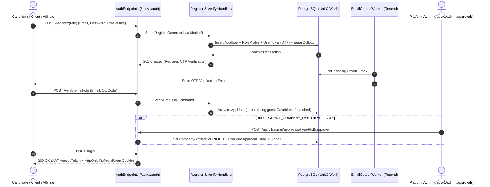
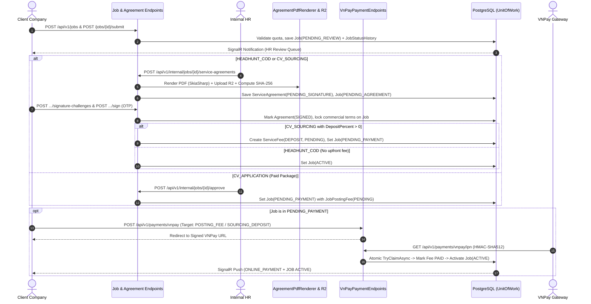
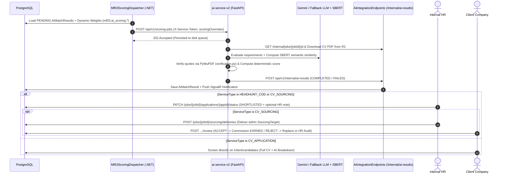
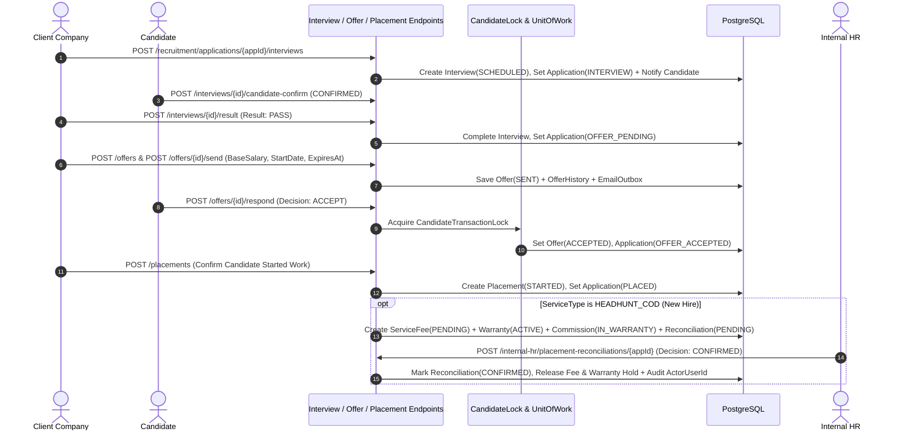
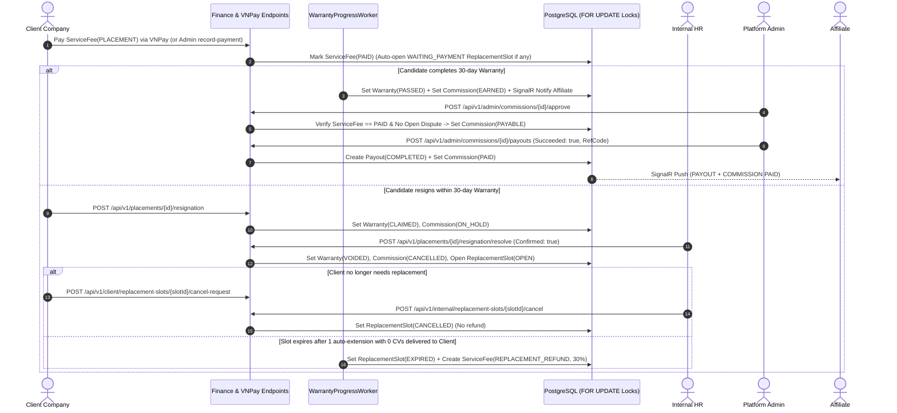

# HR Connect — End-to-End Main Flows & Execution Specifications

> **Phiên bản:** 3.0 (Production Synchronized — 11/2026)  
> **Đối chiếu trực tiếp từ mã nguồn:** `HRConnect.Presentation`, `HRConnect.Application`, `HRConnect.Infrastructure`, `ai-service-v2`, `HRConnect-FE`.

---

## 0. Ma Trận Phân Biệt 3 Mô Hình Dịch Vụ Xuyên Suốt Pipeline

Năm Main Flow cốt lõi (**MF-01 → MF-05**) cùng hệ thống **Auth & Onboarding (MF-00)** chia sẻ một trục thực thể thống nhất (`Company → Job → Submission → Application → Interview → Offer → Placement → ServiceFee / Warranty / Commission → Payout`), nhưng rẽ nhánh chặt chẽ theo `ServiceType.Code`:

| Tiêu chí | `HEADHUNT_COD` | `CV_SOURCING` | `CV_APPLICATION` |
| :--- | :--- | :--- | :--- |
| **Điều kiện mở Job (MF-01)** | Ký `ServiceAgreement` → `ACTIVE` ngay | Ký `ServiceAgreement` → Thu cọc `DEPOSIT` (`PENDING_PAYMENT`) → `ACTIVE` | Gói `FREE` (giới hạn quota) → `ACTIVE` ngay; gói trả phí → thu `JobPostingFee` → `ACTIVE` |
| **Nguồn nộp hợp lệ (MF-02)** | `AFFILIATE` (bắt buộc Candidate `CONFIRMED` Consent 48h) | `AFFILIATE` (bắt buộc Candidate `CONFIRMED` Consent 48h) | `CANDIDATE` tự nộp trực tiếp (không cần bước Consent) |
| **Chấm điểm AI (MF-03)** | Tự động bất đồng bộ qua `ai-service-v2` | Tự động bất đồng bộ qua `ai-service-v2` | Tự động bất đồng bộ qua `ai-service-v2` |
| **Chủ thể sàng lọc (MF-03)** | `INTERNAL_HR` tiền sàng lọc; che Email/SĐT/CV gốc với Client cho tới khi `PLACED` | `INTERNAL_HR` tiền sàng lọc & bàn giao CV (`SourcingDelivery`) tối đa `SourcingTarget` | `CLIENT_COMPANY_USER` trực tiếp xem CV gốc và sàng lọc |
| **Tuyển dụng & Đối soát (MF-04)** | Client phỏng vấn, gửi Offer, xác nhận `PLACED`; `INTERNAL_HR` đối soát độc lập (`PlacementReconciliation`) | Client nghiệm thu CV trong `ReviewDays` (phỏng vấn/tuyển dụng là tùy chọn sau bàn giao) | Client phỏng vấn, gửi Offer và xác nhận `PLACED` (không cần HR đối soát phí) |
| **Phí, Bảo hành & Hoa hồng (MF-05)** | Phí `BaseSalary × FeeMultiplier` từng Placement; bảo hành 30 ngày + tối đa 1 `ReplacementSlot` miễn phí; Affiliate nhận 100% hoa hồng sau bảo hành khi phí đã `PAID` | Quyết toán `BillableCvs × PricePerCv - PaidDeposit` (`SETTLEMENT` hoặc hoàn `CREDIT`); mỗi CV `ACCEPTED` / `AUTO_ACCEPTED` sinh ngay hoa hồng `EARNED` | Không có phí tuyển thành công, không bảo hành, không hoa hồng |

---

## MF-00. Xác Thực, Onboarding Doanh Nghiệp/Affiliate & Phân Quyền RBAC Động

### 1. Luồng thực thi chi tiết (Step-by-Step)
1. **Endpoint (`AuthEndpoints.cs`):**
   - Nhận `POST /api/v1/auth/register/candidate`, `/register/affiliate`, hoặc `/register/client` (áp dụng rate-limit policy `auth-registration`).
2. **Validation & Handler (`RegisterCandidateCommandHandler` / `RegisterAffiliateCommandHandler` / `RegisterClientCommandHandler`):**
   - Kiểm tra trùng email qua bảng `user_email_identities` (email chuẩn hóa lowercase).
   - Băm mật khẩu bằng `BCrypt.Net-Next`, tạo `AppUser (Status = PENDING_VERIFICATION)`, tạo hồ sơ vai trò tương ứng (`Candidate` / `AffiliateProfile` + `AffiliateApplication` / `Company` + `CompanyUser` + `CompanyVerificationRequest`).
   - Đặc biệt với Candidate: nếu email trùng với một hồ sơ `Candidate` tạm (`UserId == null`) do Affiliate giới thiệu trước đó, `CandidateRegistrationIdentity` chuẩn bị liên kết hồ sơ cũ về tài khoản chính chủ sau khi xác thực OTP.
   - Ghi mã OTP (lưu hash) và đẩy bản ghi vào bảng `email_outbox` trong cùng transaction (`IUnitOfWork`).
3. **Background Outbox & OTP Verification:**
   - `AccountLifecycleEmailOutboxWorker` đọc `email_outbox` và gửi email qua Resend API.
   - Người dùng gọi `POST /api/v1/auth/verify-email-otp` → kích hoạt email. Candidate dùng được ngay; Client Company và Affiliate chờ `PLATFORM_ADMIN` phê duyệt tại `/api/v1/admin/approvals/*` (`AdminApprovalService`).
4. **Phiên đăng nhập & RBAC (`LoginCommandHandler` & `RefreshTokenCommandHandler`):**
   - `POST /api/v1/auth/login` kiểm tra trạng thái tài khoản, tổng hợp tập quyền hạn hiệu lực từ `user_roles → role_permissions` (74+ permissions), phát hành JWT Access Token ngắn hạn kèm `RefreshToken` lưu trong HttpOnly Secure Cookie.
   - Khi phát hiện tái sử dụng Refresh Token đã thu hồi (token reuse), hệ thống thu hồi toàn bộ chuỗi phiên và ghi `AuditLog` (`RefreshTokenReuseDetected`).

### 2. Mermaid Sequence Diagram (MF-00)



---

## MF-01. Tạo Tin Tuyển Dụng, Thương Lượng Hợp Đồng Dịch Vụ, Thanh Toán & Mở Tuyển

### 1. Luồng thực thi chi tiết (Step-by-Step)
1. **Tạo & Gửi duyệt Job (`JobEndpoints.cs` → `CreateJobCommand` / `SubmitJobCommand`):**
   - Client gọi `POST /api/v1/jobs` (tùy chọn truyền `templateId` từ `GET /api/v1/job-templates` để sao chép bộ tiêu chí `MUST_HAVE` / `SHOULD_HAVE` độc lập và tăng `usage_count`).
   - `JobHandlerGuards.GetOwnedJobAsync` xác minh tài khoản thuộc công ty `VERIFIED` và thành viên `ACTIVE`.
   - Khi gọi `POST /api/v1/jobs/{jobId}/submit`: nếu là gói `CV_APPLICATION` `FREE`, kiểm tra giới hạn tin đang mở (`mf01.cv_application.free_active_limit`) và chu kỳ chờ (`mf01.cv_application.free_cooldown_months`), đồng bộ bản ghi `JobPostingFee`, chuyển `DRAFT → PENDING_REVIEW` và ghi `JobStatusHistory`.
2. **Duyệt nội dung & Thương lượng Hợp đồng dịch vụ (`ServiceAgreementEndpoints.cs`):**
   - Với `CV_APPLICATION`: Internal HR gọi `POST /api/v1/internal/jobs/{jobId}/approve` → gói `FREE` lên thẳng `ACTIVE`; gói trả phí chuyển `PENDING_PAYMENT`.
   - Với `HEADHUNT_COD` và `CV_SOURCING`: Internal HR gọi `POST /api/v1/internal/jobs/{jobId}/service-agreements` (`CreateServiceAgreementProposalCommand`) để chốt điều khoản thương mại (`FeeMultiplier`, `WarrantyDays`, `PaymentDueDays` hoặc `SourcingTarget`, `PricePerQualifiedCv`, `DepositPercent`, `ReviewDays`), render file PDF qua `AgreementPdfRenderer` (`SkiaSharp`), lưu lên Cloudflare R2 kèm `DocumentSha256Hash` và chuyển Job sang `PENDING_AGREEMENT`.
3. **Ký Hợp đồng dịch vụ (2 phương thức):**
   - **Ký điện tử OTP:** Người liên hệ chính của Client gọi `POST .../signature-challenges` → nhận OTP → gọi `POST .../sign` (`SignServiceAgreementCommand`). Hợp đồng chuyển `SIGNED`, chốt điều khoản lên `Job`. Nếu `HEADHUNT_COD` (hoặc `CV_SOURCING` không cọc) → Job `ACTIVE`; nếu `CV_SOURCING` có `DepositPercent > 0` → sinh `ServiceFee (Kind = DEPOSIT, Status = PENDING)` và chuyển Job sang `PENDING_PAYMENT`.
   - **Tải PDF ký ướt:** Client tải bản PDF đã đóng dấu qua `UploadSignedServiceAgreementCommand` (kiểm tra PDF hợp lệ + SHA-256) → Internal HR xác nhận qua `ApproveJobCommand` → chốt `SIGNED` và chuyển `ACTIVE` hoặc `PENDING_PAYMENT`.
4. **Thanh toán VNPay / Đối soát thủ công & Kích hoạt Job (`VnPayPaymentEndpoints.cs`):**
   - Client gọi `POST /api/v1/payments/vnpay` (target `POSTING_FEE` hoặc `SOURCING_DEPOSIT`; chặn thanh toán nếu hạn nhận hồ sơ của tin chưa mở đã hết hạn).
   - Khi VNPay gọi `GET /api/v1/payments/vnpay/ipn` hoặc trình duyệt quay về `/return`: `VnPayGateway` xác thực chữ ký `HMAC-SHA512` bằng `FixedTimeEquals`, dùng `TryClaimAsync` (`ExecuteUpdateAsync` atomic) để đánh dấu `PAID`, chuyển `Job` từ `PENDING_PAYMENT → ACTIVE`, ghi `AuditLog` và bắn thông báo SignalR.
5. **Đóng Job & Tự động hết hạn (`CloseJobCommand` & `JobExpirationWorker`):**
   - Khi Client gọi `POST /api/v1/jobs/{jobId}/close` từ trạng thái `PENDING_PAYMENT`, hệ thống tự động hủy (`CANCELLED`) các phiếu `JobPostingFee` / `ServiceFee(DEPOSIT)` chưa thanh toán.
   - `JobExpirationWorker` quét định kỳ các tin quá `ApplicationDeadline` hoặc hết hạn gói đăng tin để chuyển sang `EXPIRED` và gửi cảnh báo trước 1 ngày cho tin sắp hết hạn.

### 2. Mermaid Sequence Diagram (MF-01)



---

## MF-02. Quản Lý CV, Ứng Tuyển, Affiliate Giới Thiệu (48h Consent), Chống Trùng 2 Lớp & Attribution

### 1. Luồng thực thi chi tiết (Step-by-Step)
1. **Chuẩn bị CV (`CandidateEndpoints.cs` & `CvBuilderEndpoints.cs`):**
   - Candidate tải PDF trực tiếp (`CvStorageService`) hoặc lưu CV có cấu trúc từ **CV Builder** (`StructuredCvService` → `CvPdfRenderer` bằng `SkiaSharp`). Cả hai đều được kiểm tra bằng `PdfCvValidator` (`PdfPig`), lưu lên Cloudflare R2 và tính dấu vân tay nhị phân `ContentSha256` (`binary-sha256-v1`).
   - Với các CV do Affiliate gửi kèm trước đó, Candidate đã đăng nhập có thể xem chi tiết (`/candidate/affiliate-cvs/:cvId`), lưu bản sao về kho cá nhân (`POST .../adopt`) hoặc **bật/tắt quyền cho phép Affiliate tái sử dụng CV** (`PATCH /api/v1/candidates/me/affiliate-cvs/{cvId}/reuse` — `UpdateCandidateAffiliateCvReuseCommandHandler`).
2. **Nhánh A — Candidate tự ứng tuyển (`POST /api/v1/jobs/{jobId}/apply` → `ApplyJobCommandHandler`):**
   - Kiểm tra quyền nộp theo `service_type_allowed_role` (mặc định `CV_APPLICATION`), trạng thái Job `ACTIVE`, hạn nộp, `MaxApplications` và trạng thái `Candidate` (`ACTIVE`, chưa bị hợp nhất).
   - Khóa giao dịch bằng `ICandidateCompanyTransactionLock` (`pg_advisory_xact_lock`), kiểm tra chưa có đơn đang mở cho `(CandidateId, JobId)`.
   - Tạo ngay `Submission (Source = CANDIDATE, Status = ACCEPTED)` + `Application (Status = SUBMITTED)`, gọi `IMf03ScoringTrigger.TriggerScoringAsync` ghi bản ghi `AiMatchResult (PENDING)` trong cùng transaction và bắn SignalR.
3. **Nhánh B — Affiliate giới thiệu ứng viên (`POST /api/v1/jobs/{jobId}/candidate-submissions` → `SubmitCandidateCommandHandler`):**
   - Kiểm tra Affiliate `ACTIVE`/`VERIFIED`, Job `ACTIVE`, quyền sở hữu ứng viên 30 ngày của doanh nghiệp (`mf02.client_ownership_days`), và tự động gắn `ReplacementSlot` đang `OPEN` nếu có.
   - **Chống trùng Lớp 1 (Email & SĐT chuẩn hóa — Đồng bộ):**
     - Đối chiếu Email và SĐT sau chuẩn hóa. Nếu trùng ứng viên đã có đơn hợp lệ/đang chờ trong cùng Job → chặn ngay `409 Conflict` (`BLOCKED_DUPLICATE`). Nếu vi phạm Strict Identity Match trên hồ sơ đã xác thực (cùng Email nhưng lệch SĐT hoặc Email/SĐT trỏ về 2 hồ sơ khác nhau) → chặn `409 Conflict`.
     - Nếu ứng viên chưa từng có tài khoản, chỉ tạo hồ sơ `Candidate (UserId = null)` + lưu snapshot liên hệ lên `Submission` (chưa tạo tài khoản đăng nhập `AppUser`).
   - **Chống trùng Lớp 2 (Liên hồ sơ — `CandidateIdentityEvidence`):**
     - Khi bật `CANDIDATE_IDENTITY_DEDUP_ENABLED=true`, hệ thống băm họ tên chuẩn hóa bằng `HMAC-SHA256` (`NormalizedNameHash`) và đối chiếu cặp `(NormalizedNameHash, CvContentSha256)` trên cùng Job. Nếu phát hiện trùng với một hồ sơ `Candidate` khác (dù khác cả Email lẫn SĐT) → tự động tạo/cập nhật `CandidateDuplicateCase (RiskLevel = HIGH, ReasonCode = EXACT_CV_AND_NORMALIZED_NAME)` và bắn thông báo SignalR về Platform Admin (`/admin/candidate-identity-claims?tab=duplicates`).
   - Sinh token Consent ngẫu nhiên 32 bytes (chỉ lưu `SHA-256` hash vào `SubmissionConsent`, hạn mặc định 48 giờ từ `consent.expiration_hours`), lưu `Submission (PENDING_CONSENT)` và đẩy link `#token=...` vào `email_outbox` (kèm thông báo In-App nếu ứng viên đã có tài khoản).
4. **Ứng viên phản hồi Consent (`SubmissionConsentEndpoints.cs` → `RespondSubmissionConsentCommandHandler`):**
   - Ứng viên phản hồi qua trang Public (`/submission-consent#token=...`, không cần đăng nhập) hoặc trang In-App (`/candidate/submission-consents/:id`):
     - **`DECLINE`:** Chuyển `Consent → DECLINED`, `Submission → CONSENT_REJECTED`.
     - **`REPORT_UNAUTHORIZED`:** Hủy đơn, đồng thời thu hồi vĩnh viễn quyền tái sử dụng CV của Affiliate (`AffiliateReuseStatus = REVOKED`), lưu IP/User-Agent và ghi `AuditLog`.
     - **`CONFIRM`:** Khóa `_candidateCompanyLock`. Nếu đang có `CandidateDuplicateCase` mở trên cùng Job → tạm giữ đơn ở **`PENDING_IDENTITY_REVIEW`** (không tạo `Application`, không đẩy sang HR hay tốn lượt chấm AI). Nếu không vướng nghi trùng → chuyển `Submission → ACCEPTED`, tạo `Application (SUBMITTED)` + `Attribution (ACTIVE, Rule = CANDIDATE_CONSENT_THEN_FIRST_ACCEPTED)`, kích hoạt chấm điểm AI (MF-03) và bắn thông báo SignalR cho Affiliate + HR.
5. **Đối soát & Hợp nhất Hồ sơ Nghi trùng (`AdminCandidateDuplicateEndpoints.cs` → `ResolveCandidateDuplicateCaseCommandHandler`):**
   - Platform Admin mở Drawer chi tiết (Email/SĐT được che bảo vệ PII), xem trước tác động qua `POST .../preview-merge` (`CandidateMergePolicy` đề xuất hồ sơ gốc theo thứ tự: `VERIFIED_ACCOUNT_OWNER` → `MORE_VALID_BUSINESS_HISTORY` → `EARLIEST_CANDIDATE_RECORD`, kiểm tra không có Payout `COMPLETED`).
   - Khi Admin chọn **`MERGE`** (kèm lý do >= 10 ký tự + `ConcurrencyToken` + `IdempotencyKey`):
     - Khóa `FOR UPDATE` cả hai `Candidate` và các `Submission`/`Application` liên quan.
     - Đánh dấu hồ sơ nguồn `ARCHIVED` (`MergedIntoCandidateId = canonical.CandidateId`).
     - Xét theo thời điểm ứng viên xác nhận sớm nhất (`Consent.RespondedAt`): đơn hợp lệ sớm nhất giữ/hoàn tất `ACCEPTED` (`FinalizeIdentityReviewedSubmissionService` tạo `Application` + `Attribution` + kích hoạt AI nếu đang tạm giữ); toàn bộ các đơn nộp trùng còn lại (kể cả đang `PENDING_IDENTITY_REVIEW`, `PENDING_CONSENT` hay `ACCEPTED`) đều tự động chuyển sang **`BLOCKED_DUPLICATE`** (đóng `Consent` đang `PENDING` sang `CANCELLED`). Nếu cả hai bên đều chưa có đơn xác nhận (`winner == null`), các đơn `PENDING_CONSENT` của hồ sơ nguồn được chuyển `CandidateId` về hồ sơ gốc để ứng viên vẫn xác nhận được bình thường.

### 2. Mermaid Sequence Diagram (MF-02 — Affiliate Referral, Consent & 2-Layer Dedup)

```mermaid
sequenceDiagram
    autonumber
    actor AffA as Affiliate A
    actor AffB as Affiliate B
    participant EP as Affiliate & Consent Endpoints
    participant Lock as AdvisoryLock & Dedup Repo
    participant DB as PostgreSQL
    actor Cand as Candidate (Guest / Logged-in)
    actor Admin as Platform Admin

    AffA->>EP: POST /jobs/{jobId}/candidate-submissions (Email1, Phone1, CV.pdf)
    EP->>Lock: Check Layer 1 (Email/Phone) & Layer 2 (CV SHA-256 + Name HMAC)
    EP->>DB: Save CandidateA + SubmissionA(PENDING_CONSENT) + ConsentTokenHash + EmailOutbox
    Cand->>EP: POST /submission-consents/respond (TokenA, CONFIRM)
    EP->>DB: SubmissionA(ACCEPTED) + Application(SUBMITTED) + Attribution(AffA) + Queue AI

    alt Layer 1 Duplicate (Same Email or Same Phone)
        AffB->>EP: POST /jobs/{jobId}/candidate-submissions (Email2, Phone1, CV.pdf)
        EP-->>AffB: 409 Conflict (BLOCKED_DUPLICATE — Attribution of AffA preserved)
    else Layer 2 Cross-Profile Duplicate (New Email2 + New Phone2, Same Name + Same CV.pdf)
        AffB->>EP: POST /jobs/{jobId}/candidate-submissions (Email2, Phone2, CV.pdf)
        EP->>DB: Create CandidateB + SubmissionB(PENDING_CONSENT) + CandidateDuplicateCase(HIGH)
        DB-->>Admin: SignalR Push (CANDIDATE_DUPLICATE_CASE)
        opt Candidate confirms TokenB before Admin merges
            Cand->>EP: POST /submission-consents/respond (TokenB, CONFIRM)
            EP->>DB: Hold SubmissionB at PENDING_IDENTITY_REVIEW (No Application, No AI)
        end
        Admin->>EP: POST /admin/candidate-duplicate-cases/{id}/resolve (Decision: MERGE)
        EP->>DB: Archive CandidateB -> Canonical CandidateA; Set SubmissionB = BLOCKED_DUPLICATE
        DB-->>AffB: SignalR Refresh (Status: Bị chặn do trùng)
    end
```

---

## MF-03. Chấm Điểm AI Trọng Số Động (`ai-service-v2`), Sàng Lọc Hồ Sơ & Bàn Giao CV Sourcing

### 1. Luồng thực thi chi tiết (Step-by-Step)
1. **Dispatch bất đồng bộ kèm Trọng số Động (`Mf03ScoringDispatcher.cs`):**
   - Worker quét bảng `ai_match_results` lấy các bản ghi `PENDING` (hoặc `PROCESSING` bị treo quá timeout, tối đa `MaxDispatchAttempts = 5` với Exponential Backoff `30s → 900s`).
   - Đọc 5 tham số cấu hình động từ `IAdminBusinessSettings` (`mf03.ai_scoring.must_have_weight`, `should_have_weight`, `semantic_weight`, `llm_fit_weight`, `knockout_cap_score` — Admin chỉnh trực tiếp tại `/admin/settings` qua `PUT /api/v1/admin/settings`) và gửi `POST /api/v1/scoring-jobs` kèm `X-Service-Token` và `scoringOverrides` sang `ai-service-v2`.
2. **Xử lý chấm điểm & Hậu kiểm bằng chứng tại `ai-service-v2`:**
   - Lưu job vào hàng đợi bền vững trên đĩa (`pending-scoring-jobs.json`), kiểm tra khóa màu `active-color` (Blue/Green), trả ngay `202 Accepted`.
   - Worker Python gọi `GET /api/v1/internal/jobs/{jobId}/jd` và lấy Presigned URL tải CV từ Cloudflare R2.
   - Gọi LLM (`gemini` → fallback models → fallback providers) để đánh giá từng yêu cầu và trích xuất câu bằng chứng nguyên văn.
   - `verification.py` đối chiếu từng câu trích dẫn với văn bản đọc từ `PyMuPDF` (`quote_min_token_ratio = 0.85`) và kiểm tra số năm kinh nghiệm (`years_tolerance = 0.25`); nếu trích dẫn không tồn tại trong CV gốc, hạ trạng thái và gắn cờ `requiresManualReview = true`.
   - `semantic.py` tính điểm tương đồng ngữ nghĩa bằng Sentence-BERT; `scoring.py` tính tổng điểm tất định theo `scoringOverrides` (chặn trần `knockout_cap_score = 59` nếu thiếu bất kỳ tiêu chí `MUST_HAVE` nào).
   - Gửi kết quả về `POST /api/v1/internal/ai-results` (`AiResultCallbackProcessor` lưu `AiMatchResult`, ghi `AuditLog` và bắn SignalR cập nhật giao diện HR/Client). Nếu mọi LLM đều lỗi/quá tải, trả `FAILED` (`AI_PROVIDER_UNAVAILABLE`) — **không chặn luồng sàng lọc thủ công** và cho phép HR bấm **Yêu cầu chấm lại** (`POST /api/v1/internal/applications/{id}/ai-scoring/retry`).
3. **Tiền sàng lọc theo loại dịch vụ (`RecruitmentEndpoints.cs` → `UpdateApplicationScreeningStatusCommandHandler`):**
   - `ScreeningPolicy` phân quyền: `CV_APPLICATION` do Client sàng lọc; `HEADHUNT_COD` và `CV_SOURCING` do Internal HR tiền sàng lọc (`/hr/screening`).
   - Mở hồ sơ tự gọi `POST .../start-screening` (`SUBMITTED → SCREENING`).
   - Bấm **Chọn gửi Client (`SHORTLISTED`)**: truyền kèm `ConcurrencyToken` và **ghi chú nhận xét tùy chọn của HR (`reason`)** — được lưu vào `Application.StatusReason` và `ApplicationStatusHistory` hiển thị trên Timeline cho cả HR và Client. Với `HEADHUNT_COD`, Client xem hồ sơ `SHORTLISTED` qua `MaskedCvService` (`GET /api/v1/recruitment/applications/{id}/cv/masked` — tự động che Email, SĐT và URL trên PDF).
   - Bấm **Loại hồ sơ (`REJECTED`)**: bắt buộc truyền `ReasonCode` chuẩn.
4. **Bàn giao & Nghiệm thu CV Sourcing (`SourcingDeliveryEndpoints.cs` → `SourcingDeliveryFeatures.cs`):**
   - Internal HR gọi `POST /api/v1/jobs/{jobId}/sourcing/deliveries` để giao các CV `SHORTLISTED` (không vượt `SourcingTarget`).
   - Trong hạn `ReviewDays`, Client gọi `POST .../review` để `ACCEPT` (sinh ngay `Commission (EARNED)` cho Affiliate) hoặc `REJECT` kèm mã lý do hợp lệ (thông báo real-time cho cả HR và Affiliate). Quá hạn không phản hồi → `SourcingAutoAcceptWorker` tự động chuyển `AUTO_ACCEPTED`. Nếu từ chối với mã `OTHER`, Internal HR thẩm định giữ nguyên hoặc bác bỏ; CV từ chối hợp lệ được thay bằng CV dự phòng (`POST .../replace`).

### 2. Mermaid Sequence Diagram (MF-03)



---

## MF-04. Phỏng Vấn Đa Vòng, Offer Hợp Nhất, Nhận Việc (`Placement`) & Đối Soát Độc Lập

### 1. Luồng thực thi chi tiết (Step-by-Step)
1. **Quản lý Phỏng vấn (`InterviewEndpoints.cs`):**
   - Client gọi `POST /api/v1/recruitment/applications/{applicationId}/interviews` (`ScheduleInterviewCommand`) → kiểm tra unique index `ux_interview_one_scheduled_per_application`, chuyển `Application → INTERVIEW`, tạo `Interview (SCHEDULED)`, ghi `EmailOutbox` và đẩy SignalR (`interview.updated`).
   - Candidate xác nhận tham dự hoặc xin dời lịch qua `POST /api/v1/interviews/{id}/candidate-confirm`.
   - Sau buổi phỏng vấn, Client ghi kết quả (`POST /api/v1/interviews/{id}/result`):
     - `PASS` → `Application` chuyển `OFFER_PENDING` (hoặc tạo vòng phỏng vấn tiếp theo).
     - `BACKUP` → `Application` chuyển `BACKUP` (xử lý sau qua `DecideBackupApplicationCommand`).
     - `FAIL` → `Application` chuyển `INTERVIEW_FAILED`.
2. **Thư mời nhận việc phiên bản hóa (`OfferEndpoints.cs`):**
   - Client tạo và gửi Offer (`POST /api/v1/offers`, `POST /api/v1/offers/{id}/send`), lưu lịch sử các lần điều chỉnh điều khoản lương/ngày đi làm. Trên giao diện Client & Candidate, hệ thống hiển thị thẻ Offer hiện hành thống nhất kèm modal lịch sử điều chỉnh và thanh tiến trình 5 bước rõ ràng.
   - Candidate phản hồi qua `POST /api/v1/offers/{id}/respond` dưới khóa `ICandidateTransactionLock`: `ACCEPT` → `Application (OFFER_ACCEPTED)`; `DECLINE` → `OFFER_DECLINED`. Nếu quá `ExpiresAt`, `OfferExpiryWorker` tự chuyển sang `EXPIRED`.
3. **Xác nhận đi làm thực tế (`PlacementEndpoints.cs` → `ConfirmStartWorkCommandHandler`):**
   - Client có thể lùi ngày dự kiến đi làm tối đa 3 lần (không quá 60 ngày). Khi ứng viên nhận việc thực tế, Client gọi `ConfirmStartWorkCommand`:
     - Chuyển `Application → PLACED`, tạo `Placement (STARTED)` và tự động đóng các đơn đang mở khác của ứng viên trong cùng công ty.
     - Nếu thuộc `HEADHUNT_COD`:
       - Trường hợp lấp vào `ReplacementSlot` đang `OPEN`: đánh dấu suất `FILLED`, không tạo phí mới, mở `Warranty (ACTIVE)` và `Commission (IN_WARRANTY)` gắn với phí gốc.
       - Trường hợp tuyển mới: tạo `ServiceFee (Kind = PLACEMENT, Status = PENDING)`, `Warranty (ACTIVE, 30 ngày)`, `Commission (IN_WARRANTY)` và tạo bản ghi đối soát **`PlacementReconciliation (Status = PENDING)`**.
4. **Đối soát độc lập & Sửa ngày đi làm (`PlacementReconciliationEndpoints.cs` — UC-41):**
   - Internal HR liên hệ xác minh độc lập và gọi `POST /api/v1/internal-hr/placement-reconciliations/{applicationId}`:
     - `CONFIRMED`: mở khóa chu kỳ thu phí `ServiceFee` và cho phép hoàn tất bảo hành khi đủ hạn (ghi nhận đúng `ActorUserId` vào `AuditLog`).
     - `FLAGGED`: tạm khóa thu phí/bảo hành và chuyển lên Platform Admin phân xử (`/api/v1/admin/placement-reconciliations/*`).
   - Trong vòng **7 ngày** từ `ConfirmedAt`, Internal HR có thể sửa lại ngày bắt đầu thực tế (`CorrectPlacementStartDateCommand`), tự động tính lại hạn thanh toán phí và ngày kết thúc bảo hành.

### 2. Mermaid Sequence Diagram (MF-04)



---

## MF-05. Công Nợ Phí Dịch Vụ, VNPay, Bảo Hành 30 Ngày, Suất Thay Thế, Quyết Toán Sourcing, Khiếu Nại & Payout

### 1. Luồng thực thi chi tiết (Step-by-Step)
1. **Thu phí dịch vụ & Quyết toán Sourcing (`FinanceEndpoints.cs` & `VnPayPaymentEndpoints.cs`):**
   - Với `HEADHUNT_COD`: sau khi `PlacementReconciliation == CONFIRMED`, `WarrantyProgressWorker` theo dõi hạn thanh toán (`PENDING → DUE → OVERDUE`). Client thanh toán trực tuyến qua **VNPay** (`POST /api/v1/payments/vnpay`, target `SERVICE_FEE`) hoặc Platform Admin đối chiếu sao kê ghi nhận qua `POST /api/v1/admin/service-fees/{id}/record-payment` (khóa `FOR UPDATE`).
   - Với `CV_SOURCING`: khi Job đủ chỉ tiêu `SourcingTarget` hoặc đã `CLOSED` và không còn CV chờ phản hồi, `SourcingFinanceWorker` (hoặc `POST /api/v1/jobs/{jobId}/sourcing-settlement`) tính `Balance = BillableCvs × PricePerCv - PaidDeposit` (chỉ tính cọc đã `PAID`, tự hủy phiếu cọc chưa trả): nếu `Balance > 0` sinh phiếu `SETTLEMENT (PENDING)`; nếu `Balance < 0` sinh phiếu hoàn tiền `CREDIT (REFUND_PENDING)`.
2. **Bảo hành 30 ngày & Vòng đời Suất tuyển thay thế (`Warranty` & `ReplacementSlot`):**
   - **Đủ 30 ngày không nghỉ:** `WarrantyProgressWorker` tự động chuyển `Warranty (ACTIVE → PASSED)` và nâng `Commission (IN_WARRANTY → EARNED)` (nếu Affiliate đang `SUSPENDED` thì giữ ở `ON_HOLD`).
   - **Ứng viên nghỉ việc trong hạn bảo hành:**
     - Client gọi `POST /api/v1/placements/{placementId}/resignation` → `Warranty` sang `CLAIMED`, `Commission` sang `ON_HOLD`.
     - Internal HR xác minh qua `POST .../resignation/resolve`: nếu bác bỏ → khôi phục `ACTIVE` / `IN_WARRANTY`; nếu xác nhận nghỉ → `Warranty` sang `VOIDED`, `Commission` sang `CANCELLED`, và mở **1 Suất tuyển thay thế miễn phí (`ReplacementSlot`)** (`OPEN` nếu phí gốc đã `PAID`, hoặc `WAITING_PAYMENT` chờ Client thanh toán phí gốc kèm nút điều hướng deep-link sang đúng dòng công nợ trên trang Billing).
   - **Gia hạn, Yêu cầu hủy & Hoàn phí một phần của `ReplacementSlot`:**
     - Chạm `ExpiresAt` lần đầu → tự động gia hạn 1 lần (`mf05.replacement.extension_days`, mặc định 30 ngày).
     - Hết hạn sau gia hạn → chuyển `EXPIRED`; nếu chưa có bất kỳ hồ sơ thay thế nào được chuyển tới Client, tự động tạo phiếu hoàn phí `REPLACEMENT_REFUND` (`mf05.replacement.refund_percent`, mặc định 30%).
     - Nếu doanh nghiệp không còn nhu cầu tuyển thay thế: Client gọi `POST /api/v1/client/replacement-slots/{id}/cancel-request` (`RequestCancelReplacementSlotCommand`) gửi yêu cầu hủy kèm lý do → Internal HR xác nhận qua `POST /api/v1/internal/replacement-slots/{id}/cancel` (`CancelReplacementSlotCommand` → chuyển `CANCELLED`, không sinh hoàn phí).
3. **Khiếu nại Attribution (`DisputeEndpoints.cs`), Duyệt Hoa hồng & Chi trả (`Payout`):**
   - Affiliate có đơn bị `BLOCKED_DUPLICATE` có thể gửi khiếu nại trong `dispute.window_days` (`POST /api/v1/disputes`). Khi có `Dispute` hoặc `CandidateDuplicateCase` đang mở, hệ thống chặn duyệt chi hoa hồng liên quan (`409 COMMISSION_UNDER_DISPUTE`). Platform Admin phân xử tại `POST /api/v1/admin/disputes/{id}/resolve` (`UPHELD` chuyển quyền `Attribution` và hoa hồng chưa chi sang Affiliate thắng; hoặc `REJECTED`).
   - Khi `Commission == EARNED` và khoản phí dịch vụ hiệu lực đã `PAID`, Platform Admin gọi `POST /api/v1/admin/commissions/{id}/approve` (`EARNED → PAYABLE`), sau đó tạo và xác nhận đợt chuyển khoản thực tế qua `POST /api/v1/admin/commissions/{id}/payouts` (`Payout: COMPLETED`, `Commission: PAID`).

### 2. Mermaid Sequence Diagram (MF-05 — Headhunt Fee, Warranty, Replacement Slot & Payout)



---

## Phụ Lục: Trạng Thái Thực Tế Các Luồng Bổ Trợ (SF-01 → SF-09)

Toàn bộ 9 luồng bổ trợ đều **đã hoàn thiện cả Backend lẫn Frontend** trên Production:

| Mã | Tên luồng bổ trợ | Endpoint / Worker thực tế | Giao diện Frontend tương ứng |
| :---: | :--- | :--- | :--- |
| **SF-01** | Đăng ký & Phê duyệt Doanh nghiệp | `POST /api/v1/auth/register/client`, `/api/v1/admin/approvals/companies/*` | `/register`, `/admin/approvals` |
| **SF-02** | Đăng ký & Phê duyệt Affiliate + Tính điểm Uy tín | `POST /api/v1/auth/register/affiliate`, `AffiliatePerformanceWorker` | `/register`, `/affiliate/performance`, `/admin/approvals` |
| **SF-03** | Xác nhận Consent 48h (Public Token & In-App) | `/api/v1/submission-consents/*`, `SubmissionConsentExpiryWorker` | `/submission-consent#token=...`, `/candidate/applications` |
| **SF-04** | Khiếu nại Tranh chấp Attribution (`Dispute`) | `/api/v1/disputes/*`, `/api/v1/admin/disputes/*` | `/affiliate/disputes`, `/admin/disputes` |
| **SF-05** | Yêu cầu Tư vấn Doanh nghiệp (Nghị định 13/2023) | `POST /api/v1/public/contact-requests`, `/api/v1/admin/contact-requests/*` | Trang chủ / Dịch vụ, `/admin/contact-requests`, `/hr/contact-requests` |
| **SF-06** | Công cụ Tạo CV Trực tuyến (`CV Builder` PDF) | `/api/v1/cv-templates`, `/api/v1/candidates/cv/structured/*` | `/candidate/cv-builder`, `/candidate/cvs` |
| **SF-07** | Gợi ý Việc làm Tự động bằng Sentence-BERT | `JobMatchWorker` → `POST /api/v1/semantic-match`, `/api/v1/candidates/me/job-matches` | Cổng Candidate (Việc làm gợi ý) |
| **SF-08** | Thông báo Realtime SignalR & Đồng bộ Query Cache | `/hubs/notifications`, `NotificationPushInterceptor` | `NotificationBell.tsx`, `notificationRefreshKeys.ts` |
| **SF-09** | Phân cấp Ngành nghề 3 cấp & Danh bạ Công ty | `/api/v1/industries`, `/api/v1/public/companies/*` | `/companies`, `/jobs`, `/admin/users` |
