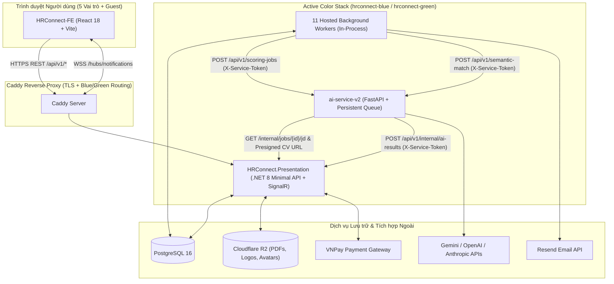

# HR Connect — System Architecture & Technical Specification

> **Phiên bản:** 3.0 (Đồng bộ mã nguồn thực tế nhánh `main` / `docs/sync-expanded-scope` — 11/2026)  
> **Nguồn sự thật (Source of Truth):** Mã nguồn thực thi tại `HRConnect/`, `HRConnect-FE/`, `ai-service-v2/` và `deploy/`.

---

## 1. Mục Đích Cốt Lõi & Phạm Vi Hệ Thống Hiện Hành (Current System Scope)

**HR Connect** là nền tảng tuyển dụng đa mô hình dành cho Agency (B2B2C & Affiliate Headhunting Network), kết nối 5 nhóm tác nhân đã xác thực (**Platform Admin**, **Internal HR**, **Client Company User**, **Affiliate**, **Candidate**) cùng khách vãng lai (**Guest**).

### 1.1. Phạm vi nghiệp vụ đã vận hành thực tế trong code
1. **Đa mô hình dịch vụ tuyển dụng (`ServiceType`):**
   - **`HEADHUNT_COD` (Tuyển dụng theo kết quả):** Ký hợp đồng dịch vụ điện tử (`ServiceAgreement`), Affiliate giới thiệu ứng viên có xác nhận Consent 48 giờ, Internal HR tiền sàng lọc, che thông tin liên hệ ứng viên (`MaskedCvService`) trước khi nhận việc, đối soát nhận việc độc lập (`PlacementReconciliation`), thu phí `BaseSalary × FeeMultiplier`, bảo hành 30 ngày (`Warranty`), mở tối đa 1 suất tuyển thay thế miễn phí (`ReplacementSlot`), chi trả 100% hoa hồng sau bảo hành.
   - **`CV_SOURCING` (Tìm kiếm & Cung cấp CV đạt chuẩn):** Ký hợp đồng dịch vụ, thu tiền đặt cọc (`DEPOSIT`) trước khi mở tuyển, Internal HR bàn giao CV (`SourcingDelivery`) theo hạn mức `SourcingTarget`, Client nghiệm thu trong `ReviewDays` (quá hạn tự động `AUTO_ACCEPTED`), quyết toán cuối kỳ (`SETTLEMENT` hoặc hoàn cọc dư `CREDIT`), sinh hoa hồng `EARNED` trên từng CV đạt chuẩn.
   - **`CV_APPLICATION` (Đăng tin & Nhận hồ sơ trực tiếp):** Gói đăng tin `FREE` (giới hạn số tin mở và chu kỳ mở lại) hoặc trả phí `STANDARD` (`JobPostingFee`), ứng viên tự nộp trực tiếp, AI chấm điểm hỗ trợ và Client trực tiếp sàng lọc.
2. **Quản trị định danh & Chống nộp trùng 2 lớp:**
   - **Lớp 1 (Đồng bộ):** Chuẩn hóa Email & Số điện thoại, kiểm tra Strict Identity Match và chặn tức thời `409 BLOCKED_DUPLICATE` dưới khóa giao dịch PostgreSQL.
   - **Lớp 2 (Liên hồ sơ):** Đối chiếu dấu vân tay nhị phân PDF (`ContentSha256`) kết hợp mã băm `HMAC-SHA256` họ tên chuẩn hóa (`NormalizedNameHash`), tự động tạo `CandidateDuplicateCase` (`RiskLevel = HIGH`), tạm giữ đơn ở `PENDING_IDENTITY_REVIEW` và cung cấp giao diện đối soát/hợp nhất mềm cho Platform Admin (`/admin/candidate-identity-claims?tab=duplicates`).
3. **AI Chấm điểm & Hậu kiểm bằng chứng (`ai-service-v2`):**
   - Kiến trúc Hybrid kết hợp **Multi-Provider LLM** (Google Gemini chính, chuỗi model dự phòng và fallback sang OpenAI/Anthropic) + **Sentence-BERT** (`paraphrase-multilingual-MiniLM-L12-v2`).
   - **Deterministic Scoring & Hallucination Verification:** LLM chỉ đánh giá trạng thái từng tiêu chí kèm trích dẫn nguyên văn; `verification.py` đối chiếu trích dẫn với văn bản PyMuPDF (`LLM_UNVERIFIED` bị hạ bậc và gắn cờ `RequiresManualReview`), `scoring.py` tính điểm theo trọng số động truyền từ `BusinessSettings` của Backend (`mf03.ai_scoring.*`).
4. **Hạ tầng Vận hành Production:**
   - Thanh toán trực tuyến **VNPay** (`POSTING_FEE`, `SOURCING_DEPOSIT`, `SERVICE_FEE`) với đồng bộ atomic giữa IPN và Browser Return.
   - Lưu trữ đối tượng **Cloudflare R2** (S3-compatible) với Presigned URL ngắn hạn.
   - Thông báo thời gian thực qua **SignalR Hub** (`/hubs/notifications`) kết hợp cơ chế tự động làm mới cache React Query (`notificationRefreshKeys.ts`).
   - Triển khai **Zero-Downtime Blue/Green Deployment** (`deploy/scripts/deploy-production.sh`, Docker Compose + Caddy Reverse Proxy + Active-Color Gating cho AI Worker).

---

## 2. Tech Stack & Thư Viện Cốt Lõi (Verified Dependencies)

### 2.1. Backend (`HRConnect/` — .NET 8)
| Thành phần | Công nghệ / Package | Phiên bản | Vai trò thực tế trong code |
| :--- | :--- | :--- | :--- |
| **Runtime & Web** | ASP.NET Core Minimal APIs (`.NET 8`) | `8.0` | Định tuyến HTTP `/api/v1/*`, Middleware pipeline, Rate Limiting, ProblemDetails |
| **CQRS & Mediator** | `MediatR` | `14.2.0` | Điều phối Command / Query theo Vertical Slices trong `HRConnect.Application` |
| **Validation** | `FluentValidation` | `12.1.1` | Kiểm tra hợp lệ đầu vào tại Endpoint / Handler trước khi chạm Domain |
| **ORM & Database** | `Npgsql.EntityFrameworkCore.PostgreSQL` | `8.0.11` | Truy cập PostgreSQL, Migrations, Row-level `FOR UPDATE` locks & Advisory Locks |
| **Auth & Security** | `JwtBearer`, `BCrypt.Net-Next` | `8.0.11` / `4.2.0` | Xác thực JWT Access Token + HttpOnly Refresh Token Cookie, băm mật khẩu BCrypt |
| **Object Storage** | `AWSSDK.S3` | `4.0.103.3` | Tích hợp Cloudflare R2 (upload/delete object, cấp Presigned Download URL) |
| **PDF Engine** | `SkiaSharp` + `PdfPig` | `3.119.1` / `0.1.16` | Render CV Builder PDF, render Hợp đồng `ServiceAgreement` PDF, tạo CV ẩn danh (`MaskedCvService`) và kiểm tra cấu trúc/số trang PDF |
| **Realtime** | ASP.NET Core SignalR | `8.0` | Đẩy thông báo realtime qua WebSocket `/hubs/notifications` |
| **Env & Docs** | `DotNetEnv`, `Swashbuckle.AspNetCore` | `3.2.0` / `6.6.2` | Nạp `.env` khi phát triển local và sinh tài liệu OpenAPI/Swagger |

### 2.2. AI Microservice (`ai-service-v2/` — Python FastAPI)
| Thành phần | Package | Phiên bản | Vai trò thực tế trong code |
| :--- | :--- | :--- | :--- |
| **API Framework** | `fastapi`, `uvicorn[standard]` | `>=0.115` / `>=0.30` | Cung cấp REST API nội bộ (`/api/v1/scoring-jobs`, `/api/v1/semantic-match`, `/health`) |
| **LLM SDKs** | `google-genai`, `openai`, `anthropic` | `>=2.30` / `>=3.31` / `>=1.13` | Đọc CV đa phương thức, bóc tách và đánh giá tiêu chí `MUST_HAVE` / `SHOULD_HAVE` |
| **Semantic NLP** | `sentence-transformers`, `numpy` | `>=3.1` / `>=1.26` | Tính vector embedding đa ngôn ngữ cho điểm ngữ nghĩa CV–JD và gợi ý việc làm |
| **Document Parser** | `PyMuPDF` (`fitz`), `python-docx` | `>=1.24` / `>=1.1` | Đọc lớp văn bản gốc từ PDF/DOCX để hậu kiểm trích dẫn chống ảo giác LLM |
| **Config & HTTP** | `pydantic-settings`, `httpx` | `>=2.5` / `>=0.27` | Quản lý cấu hình kiểu tĩnh và gọi callback bất đồng bộ có retry về Backend |

### 2.3. Frontend (`HRConnect-FE/` — React 18 + TypeScript)
| Thành phần | Package | Phiên bản | Vai trò thực tế trong code |
| :--- | :--- | :--- | :--- |
| **Core & Build** | `react`, `typescript`, `vite` | `18.3.1` / `5.4.5` / `5.3.1` | Ứng dụng SPA phân tách code-splitting theo từng cổng vai trò |
| **UI & Styling** | `antd`, `tailwindcss`, `lucide-react` | `5.18.0` / `3.4.4` / `1.61.0` | Hệ thống thiết kế riêng cho từng không gian làm việc (Admin Slate, HR Sky, Portal) |
| **State & Fetching** | `@tanstack/react-query`, `zustand`, `axios` | `5.40.0` / `4.5.4` / `1.7.2` | Quản lý server-state, tự động refresh JWT khi `401`, lưu trữ auth session & permissions |
| **Realtime & Motion** | `@microsoft/signalr`, `motion` | `10.0.11` / `14.14.0` | Lắng nghe sự kiện SignalR tự động invalidate query keys và chuyển cảnh mượt |
| **Testing** | `vitest`, `@testing-library/react`, `msw`, `@playwright/test` | `2.1.9` / `16.3.0` / `2.11.6` | Unit/Integration tests và E2E tests |

---

## 3. Cấu Trúc Thư Mục Chuẩn Hóa (Clean Architecture Directory Map)

```text
HRConnect/ (Workspace Root)
├── .github/workflows/
│   ├── ci.yml                              # Pipeline kiểm định chất lượng (BE + FE 2 shards + Coverage + AI Pytest + Security Scan)
│   └── deploy-cloud.yml                    # Pipeline đóng gói GHCR image và chạy Blue/Green deployment lên Cloud Server
├── deploy/
│   ├── caddy/                              # Cấu hình Caddyfile và active-upstreams.caddy chuyển luồng Blue/Green
│   ├── scripts/deploy-production.sh        # Script triển khai không gián đoạn, kiểm tra healthcheck & tự động rollback
│   └── compose.prod.yml                    # Định nghĩa container backend và ai-v2 giới hạn RAM/CPU trên Production
├── docs/
│   ├── README.md                           # Mục lục điều hướng tài liệu toàn dự án
│   ├── architecture.md                     # [File này] Đặc tả kiến trúc tổng thể & quy ước kỹ thuật
│   └── diagrams/                           # Sơ đồ kiến trúc, ERD, State Machine và Workflows (.mmd / .puml / .svg)
├── ai-service-v2/                          # Microservice chấm điểm CV & gợi ý việc làm (Python FastAPI)
│   ├── app/
│   │   ├── main.py                         # Khởi tạo FastAPI, xác thực X-Service-Token, endpoints nội bộ
│   │   ├── config.py                       # Cấu hình Pydantic (LLM models, fallbacks, default weights, timeouts)
│   │   ├── scoring_jobs.py                 # Hàng đợi bền vững trên đĩa, Blue/Green active-color gate & callback retry
│   │   ├── pipeline.py                     # Điều phối luồng đọc CV -> gọi LLM -> hậu kiểm -> tính điểm
│   │   ├── llm.py                          # Adapter gọi Gemini / OpenAI / Anthropic có retry & fallback chuỗi
│   │   ├── verification.py                 # Hậu kiểm câu trích dẫn (quote token ratio) & số năm kinh nghiệm
│   │   ├── semantic.py                     # Tính điểm tương đồng ngữ nghĩa bằng Sentence-BERT
│   │   └── scoring.py                      # Công thức tính điểm tất định (Deterministic Score & Knockout Cap)
│   └── tests/                              # Bộ kiểm thử pytest cho pipeline, scoring, verification và queue
├── HRConnect-FE/                           # Ứng dụng Web SPA (React 18 + TypeScript)
│   └── src/
│       ├── app/                            # Cấu hình Router, Lazy-loading & Route Prefetching
│       ├── components/                     # Layout Shells theo vai trò, NotificationBell, Guarded routes
│       ├── features/
│       │   ├── admin-console/              # Cổng Platform Admin (Dashboard, Approvals, Identity/Duplicates, Disputes, RBAC, Settings, Audit)
│       │   ├── hr-console/                 # Cổng Internal HR (Job Review, Screening Queue, Pipeline, Reconciliations, Warranty)
│       │   ├── client-console/             # Cổng Doanh nghiệp (Overview, Agreements, Candidates 5-Stage, Interviews/Offers, Billing/VNPay)
│       │   ├── jobs-mf01/                  # Form tạo/sửa Job, chọn Job Template, quản lý vòng đời Job
│       │   ├── recruitment/                # ApplicationWorkbench dùng chung (xem AI breakdown, CV gốc/che, thao tác tuyển dụng)
│       │   ├── sourcing/                   # Quản lý bàn giao, nghiệm thu và thay thế CV Sourcing
│       │   ├── finance-mf05/               # Công nợ ServiceFee, Hoa hồng Affiliate, Bảo hành & Suất thay thế
│       │   ├── portal/                     # Cổng Candidate & Affiliate (Kho CV, CV Builder, Consent, Submissions, Disputes)
│       │   └── auth/                       # Đăng nhập, Đăng ký 3 luồng, Xác thực OTP, Quên mật khẩu
│       ├── hooks/                          # useNotificationSignalR & bảng ánh xạ notificationRefreshKeys.ts
│       ├── services/api/                   # Tầng giao tiếp HTTP Axios phân tách theo domain/MF
│       ├── stores/                         # Zustand authStore (lưu thông tin người dùng, vai trò và tập quyền hạn)
│       └── types/api/                      # Định nghĩa TypeScript interfaces đồng bộ với DTO Backend
└── HRConnect/                              # Giải pháp Backend .NET 8 theo Clean Architecture
    ├── HRConnect.Domain/                   # [TẦNG MIỀN — Không phụ thuộc thư viện ngoài]
    │   ├── Entities/                       # 54+ thực thể nghiệp vụ (AppUser, Company, Job, Submission, Application, ServiceFee...)
    │   └── Constants/                      # Mã trạng thái chuẩn hóa (JobStatuses, ApplicationStates, FinanceStates...)
    ├── HRConnect.Application/              # [TẦNG ỨNG DỤNG — Quy tắc nghiệp vụ & Điều phối Use Case]
    │   ├── Common/
    │   │   ├── Exceptions/                 # BadRequestException, ForbiddenException, NotFoundException, ConflictException
    │   │   ├── Interfaces/                 # Hợp đồng Repository, IUnitOfWork, IFileStorageService, IVnPayGateway, IAuditLogService...
    │   │   └── Settings/                   # BusinessSettings (37 tham số động lưu DB), CandidateIdentityEvidenceSettings...
    │   └── Features/                       # 25 module CQRS Vertical Slices (Commands, Queries, Validators, Policies)
    ├── HRConnect.Infrastructure/           # [TẦNG HẠ TẦNG — Thực thi IO, CSDL, Tích hợp ngoài & Background Workers]
    │   ├── Persistence/                    # ApplicationDbContext, Configurations, Interceptors, Migrations & DatabaseSeeder
    │   ├── Repositories/                   # Thực thi truy vấn EF Core, khóa bi quan FOR UPDATE & Advisory Transaction Locks
    │   └── Services/                       # R2 Storage, SkiaSharp PDF Renderers, VNPay, Resend Email, AI Dispatcher & 11 Workers
    ├── HRConnect.Presentation/             # [TẦNG TRÌNH DIỄN — Giao diện giao tiếp HTTP & WebSocket]
    │   ├── Endpoints/                      # 34 nhóm Minimal API Endpoints (/api/v1/* và /api/v1/internal/*)
    │   ├── Hubs/                           # NotificationHub (/hubs/notifications) & SignalRNotificationPublisher
    │   ├── Authorization/                  # Kiểm tra quyền hạn chi tiết PermissionAuthorization
    │   ├── ErrorHandling/                  # Global Exception Handlers trả về JSON / ProblemDetails chuẩn hóa
    │   ├── Middleware/                     # RequestLoggingMiddleware gắn CorrelationId xuyên suốt request
    │   └── Program.cs                      # Điểm khởi chạy, DI wiring, cấu hình Rate Limiter & Security Pipeline
    └── HRConnect.UnitTests/                # [TẦNG KIỂM THỬ] Unit & Repository Integration Tests
```

---

## 4. Kiến Trúc Tương Tác Liên Dịch Vụ & Background Workers

### 4.1. Sơ đồ kiến trúc tổng thể



### 4.2. Danh sách 11 Hosted Background Workers trong `HRConnect.Infrastructure`

Toàn bộ tác vụ nền đều sử dụng dữ liệu bền vững trong PostgreSQL (không dựa vào trạng thái tạm trong RAM của tiến trình API):

| STT | Worker Class | Phân hệ | Nhiệm vụ thực thi định kỳ |
| :---: | :--- | :---: | :--- |
| 1 | `AccountLifecycleEmailOutboxWorker` | Auth / Common | Quét bảng `email_outbox`, gửi email qua Resend API (OTP, thông báo duyệt tài khoản, mời xác nhận Consent, Offer...), retry có giới hạn. |
| 2 | `AvatarStorageCleanupWorker` | Common Storage | Xử lý bảng `storage_cleanup_jobs` để xóa bất đồng bộ các tệp avatar/logo/CV mồ côi trên Cloudflare R2. |
| 3 | `JobExpirationWorker` | MF-01 | Đóng tự động (`EXPIRED`) các Job quá `ApplicationDeadline` hoặc hết thời hạn gói `PostingPackage`, gửi thông báo cho doanh nghiệp. |
| 4 | `SubmissionConsentExpiryWorker` | MF-02 | Chuyển các lời mời giới thiệu quá hạn (mặc định 48 giờ) từ `PENDING_CONSENT → CONSENT_EXPIRED`, lưu trữ CV tạm và thông báo cho Affiliate. |
| 5 | `Mf03ScoringDispatcher` | MF-03 | Đọc `AiMatchResult` ở trạng thái `PENDING` (hoặc `PROCESSING` bị quá hạn), nạp trọng số động từ `IAdminBusinessSettings` và gửi sang `ai-service-v2` theo cơ chế Exponential Backoff. |
| 6 | `JobMatchWorker` | MF-03 (SF-07) | Quét các Job `ACTIVE` và hồ sơ Candidate `PUBLIC`, gọi `/api/v1/semantic-match` để tạo gợi ý việc làm (`CandidateJobMatch`) và thông báo `JOB_FIT`. |
| 7 | `SourcingAutoAcceptWorker` | MF-03 | Tự động chuyển các bản ghi bàn giao CV `SourcingDelivery` quá hạn `ReviewDeadlineAt` từ `DELIVERED → AUTO_ACCEPTED` và sinh hoa hồng `EARNED`. |
| 8 | `OfferExpiryWorker` | MF-04 | Chuyển các `Offer` đang `SENT` quá hạn `ExpiresAt` sang `EXPIRED` và gửi email/thông báo cho các bên. |
| 9 | `WarrantyProgressWorker` | MF-05 | Cập nhật trạng thái công nợ (`PENDING → DUE → OVERDUE`), hoàn tất bảo hành 30 ngày (`ACTIVE → PASSED`, nâng hoa hồng `IN_WARRANTY → EARNED`), tự gia hạn 1 lần hoặc đóng `EXPIRED` các `ReplacementSlot` (sinh phiếu hoàn phí `REPLACEMENT_REFUND` nếu chưa có CV nào gửi tới Client). |
| 10 | `SourcingFinanceWorker` | MF-05 | Tự động quyết toán các Job `CV_SOURCING` đã đủ chỉ tiêu hoặc đã đóng khi không còn CV chờ phản hồi (tạo phiếu `SETTLEMENT` hoặc `CREDIT`). |
| 11 | `AffiliateCommissionHoldWorker` & `AffiliatePerformanceWorker` | MF-05 | Đồng bộ tạm giữ/mở khóa hoa hồng khi trạng thái tài khoản Affiliate thay đổi và tính toán lại chỉ số hiệu suất/hạng uy tín Affiliate (`AffiliatePerformance`). |

---

## 5. Quy Ước Kiến Trúc & Kỹ Thuật (Architectural Conventions)

### 5.1. Tổ chức Code theo Clean Architecture & Vertical Slices
- **Presentation Layer (`Endpoints/V1/*`):** Chỉ thực hiện trích xuất thông tin định danh từ `ClaimsPrincipal`, kiểm tra quyền qua `PermissionAuthorization.HasPermission(...)`, gọi `IValidator<T>` (nếu endpoint validate trực tiếp), gửi Command/Query qua `ISender` (`MediatR`) và ánh xạ sang HTTP Status chuẩn.
- **Application Layer (`Features/<Module>/*`):** Mỗi tính năng gồm `Command`/`Query`, `Validator` (`AbstractValidator<T>`) và `Handler` (`IRequestHandler<TReq, TRes>`). Không tham chiếu trực tiếp `ApplicationDbContext`, `HttpContext` hay SDK bên thứ ba.
- **Tham số nghiệp vụ động (`BusinessSettings.cs`):** Toàn bộ 37 hằng số thương mại và vận hành (hệ số phí Headhunt, ngày bảo hành, tỷ lệ chia hoa hồng Sourcing, thời hạn sở hữu ứng viên, hạn khiếu nại, 5 tham số trọng số & trần điểm AI `mf03.ai_scoring.*`...) đều đọc qua `IAdminBusinessSettings` (lưu bảng `system_setting`), tuyệt đối không hardcode trong Handler.

### 5.2. Truy cập Dữ liệu, Quản lý Giao dịch & Khóa Đồng thời (Concurrency & Locking)
1. **Optimistic Concurrency (`ConcurrencyToken`):**
   - Các thực thể nhạy cảm (`Job`, `Application`, `Interview`, `Offer`, `CandidateCv`, `CandidateIdentityClaim`, `CandidateDuplicateCase`, `Dispute`, `ReplacementSlot`, `Role`, `Permission`) đều mang `ConcurrencyToken` (`Guid`).
   - Mọi lệnh cập nhật kiểm tra khớp token; nếu lệch trả ngay `409 Conflict` để giao diện tải lại bản mới nhất.
2. **Pessimistic Row Locks & PostgreSQL Advisory Transaction Locks:**
   - Với thao tác nộp đơn và xác nhận Consent: sử dụng `ICandidateCompanyTransactionLock` và `ICandidateTransactionLock` (`pg_advisory_xact_lock`) để tuần tự hóa các giao dịch cùng ứng viên / cùng doanh nghiệp, triệt tiêu race condition bấm đúp hoặc hai Affiliate xác nhận cùng mili-giây.
   - Với thao tác tài chính, hợp nhất danh tính và xử lý tranh chấp: sử dụng `SELECT ... FOR UPDATE` (`GetServiceFeeForUpdateAsync`, `GetCommissionForUpdateAsync`, `GetByIdForUpdateAsync`, `GetCandidatesForUpdateAsync`) bên trong `IUnitOfWork.BeginTransactionAsync()`.
3. **Đồng bộ Thanh toán Atomic (`OnlinePayment`):**
   - Cả IPN server-to-server và Browser Return của VNPay đều đi qua `TryClaimAsync` (`ExecuteUpdateAsync` có điều kiện trạng thái) kết hợp unique partial index `uq_online_payment_active_target`, đảm bảo một giao dịch chỉ kích hoạt Job / gạch nợ đúng một lần duy nhất.

### 5.3. Chiến lược Xử lý Lỗi & Bảo mật API
- **Exception Mapping chuẩn hóa:**
  - `ValidationProblem` / `BadRequestException` → `400 Bad Request`
  - Chưa xác thực / Token hết hạn → `401 Unauthorized`
  - Thiếu permission hoặc vi phạm sở hữu công ty (`CompanyMembershipPolicy`) → `403 Forbidden`
  - Không tìm thấy hoặc bị ẩn theo chính sách bảo mật (`ClientVisibilityPolicy`) → `404 Not Found`
  - Xung đột trạng thái, trùng lặp ứng viên hoặc lệch `ConcurrencyToken` → `409 Conflict` (luôn kèm `errorCode` tường minh như `CANDIDATE_ALREADY_SUBMITTED`, `STALE_DUPLICATE_CASE`, `SOURCING_TARGET_REACHED`, `COMMISSION_UNDER_DISPUTE`)
  - Vượt giới hạn tần suất (`RateLimiter`) → `429 Too Many Requests` kèm `Retry-After`.
- **Bảo vệ Dữ liệu Cá nhân (PII Minimization) & Service-to-Service Security:**
  - Giao tiếp giữa Backend và `ai-service-v2` bắt buộc header `X-Service-Token` kiểm tra bằng `CryptographicOperations.FixedTimeEquals`.
  - Token xác nhận Consent của ứng viên chỉ lưu bản băm `SHA-256` trong CSDL và truyền trên URL dưới dạng fragment (`#token=...`) kèm `Referrer-Policy: no-referrer` để không lộ token vào access logs.
  - Hồ sơ `HEADHUNT_COD` tự động che Email/SĐT/Địa chỉ và chỉ cung cấp bản PDF đã xóa thông tin liên hệ (`MaskedCvService`) cho Client trước khi ứng viên chính thức nhận việc (`PLACED`).
  - Mọi thao tác thay đổi dữ liệu quan trọng đều ghi vết vào bảng `audit_logs` thông qua `IAuditLogService` kèm `ActorUserId`, `OldValues`, `NewValues` và `CorrelationId`.
